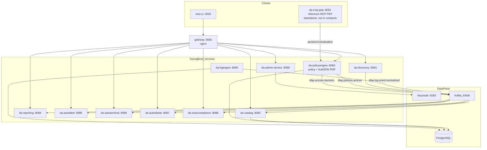

# DLAP - Data Lifecycle Automation Platform

**DLAP - Data Lifecycle Automation Platform.** Apache 2.0 licensed. An open reference implementation of data lifecycle governance for the agent era, built and released by Data Automation Labs (DALab).

**Multi-cloud data governance for the full data lifecycle** - discovery, cataloging, labeling, policy, access decisions, compliance, archival, and deletion across AWS, GCP, and Azure.

[](https://github.com/Data-Automation-Lab/dlap/actions/workflows/dlap-ci-cd.yml)
[](https://github.com/Data-Automation-Lab/dlap/blob/main/LICENSE)
[](https://openjdk.org/)

> **Status: early evaluation release.** This release has been verified on a local Docker Compose stack, with emulators (LocalStack), recorded log fixtures and automated tests. It has not been verified end to end against live cloud accounts in its current form, it is not known to run in production anywhere, and it holds no certification. Hard cloud deletion is dry-run by default and Azure coverage is partial. Read [`docs/guides/deployment.md`](docs/guides/deployment.md) before you point it at real data, and expect rough edges.

## What is DLAP?

DLAP (Data Lifecycle Automation Platform) is an **open source (Apache 2.0)** data governance platform: ten Spring Boot microservices (plus `da-mcp-pep`, a standalone reference enforcement point) and a React UI coordinate around **PostgreSQL**, **Apache Kafka (KRaft)**, and **Keycloak** to automate how organizations discover assets, attach labels, evaluate policy, serve access decisions, archive or delete data, and evidence compliance.

**The technical differentiator: DLAP is cloud-neutral and log-enriched.** Lifecycle and access decisions are driven by audit- and application-log signals normalized onto one spine - truth about assets, owners and lineage is reconstructed from audit + application logs, not read from the tools that emit them. Cloud-neutrality is enforced structurally: no cloud-provider SDK is imported in the neutral core (`core/`, `api/`, `common/`, `da-protos/`); provider code lives only under `providers/<cloud>/` (ADR-0004). See [`docs/architecture/overview.md`](docs/architecture/overview.md).

### The five lifecycle stages

Each stage has a vision-facing name and an operator-facing agent name. This is the canonical taxonomy, matching [`docs/architecture/overview.md`](docs/architecture/overview.md) §1 and [`docs/GLOSSARY.md`](docs/GLOSSARY.md):

| Stage (operator) | Stage (vision) | What happens | Owner |
|---|---|---|---|
| **Discovery** | Born | Assets are found across clouds and normalized into the catalog | `da-discovery` → `da-catalog` |
| **Label** | Enriched | Sensitivity, compliance and domain labels are applied by rules + LLM | `da-autolabel` |
| **Govern** | Governed | Policies match assets and fire lifecycle actions | `da-policyengine` |
| **Consume** | Consumed | Per-request access verdicts at read time (AuthZEN PDP) | `da-policyengine` PDP + PEPs |
| **Retire** | Retired | Policy-driven archival and secure deletion | `da-autoarchival`, `da-autodelete` |

**Consume** is the AuthZEN access-decision plane added by ADR-0040 - the one stage that answers the per-request "may this agent read this asset now?" question. It is an extension of `da-policyengine`, not a new service. Reporting (`da-reporting`) is a cross-cutting concern over all five stages, not a sixth stage. The older `Auto-Discovery / Auto-Label / Auto-Archive / Auto-Delete / Auto-Report` names are superseded; `docs/GLOSSARY.md` carries the mapping.

DLAP was built by Data Automation Labs (DALab) and released as open source under Apache 2.0. It is an independent project: it is not an Apache Software Foundation project and no incubation proposal has been filed. The governance model in [`GOVERNANCE.md`](GOVERNANCE.md) follows the Apache Way so that a later proposal stays possible. Source files carry the ASF-style license header for the same reason; the license is Apache 2.0 either way.

The platform targets teams that today juggle separate catalog, policy, and lifecycle tools. DLAP connects those concerns with shared protobuf-backed entities (`da-protos`), consistent Kafka topics (`DlapConstants.KafkaTopic`), and per-service Flyway migrations.

## Architecture at a glance



Host `8081` is the nginx API gateway, so `da-discovery` is remapped to host `8091` in the microservices compose. `da-mcp-pep` is not part of that compose; its own default `server.port` is also `8091`, so override one of them if you run both on a single host.

## Service catalog

Ports are the **host-published** ports from `deployment/environments/dev/docker-compose.microservices.yml`; inside the container network most services listen on `8080`.

| Module | Port (host) | Purpose | Kind |
| --- | ---: | --- | --- |
| da-discovery | 8091 | Multi-cloud discovery jobs and resource crawlers (AWS/GCP/Azure/Unity) | Service - Stage: Discovery |
| da-catalog | 8082 | Canonical asset + label catalog; system of record for `Asset` | Service |
| da-policyengine | 8083 | Policy definitions, evaluation, Event Center; **AuthZEN PDP** (`/access/v1/evaluation`) | Service - Stages: Govern + Consume |
| da-reporting | 8084 | Cross-service dashboards and notifications | Service (actuator on unpublished mgmt port 8380) |
| da-autolabel | 8085 | LLM-assisted labeling via `ILLMClient` | Service - Stage: Label |
| da-autoarchival | 8086 | Archival workflows | Service - Stage: Retire (Archive) |
| da-autodelete | 8087 | Secure deletion with audit trail | Service - Stage: Retire (Delete) |
| da-autocompliance | 8088 | Compliance posture → labels; control roll-up | Service |
| da-admin-service | 8089 | Users, cloud connections, admin APIs | Service |
| da-logingest | 8090 | Cloud audit-log ingest → normalized `DlapLogEvent` spine | Service - the log-enriched entry point |
| gateway | 8081 | nginx API gateway / SPA host | Infrastructure (dev compose) |
| **da-mcp-pep** | 8091 (own default) | **Reference** MCP Policy Enforcement Point - fronts an MCP server and enforces AuthZEN verdicts from the PDP | Service - Stage: Consume. **Not** in the compose; stateless (no DB, no Kafka); run separately |
| da-protos | - | Shared entities (`Asset`, `Label`, `User`, `AssetLabelAssignment`, `CloudResource`) + `DlapConstants` | Library |
| da-llm-client | - | Shared LLM provider abstraction (`ILLMClient` → `LLMClientFactory`, ADR-0044) | Library |
| new-ui | 3000 | React 19 + TypeScript operator UI (Vite) | Frontend (git submodule; the compose stack builds it) |

Azure coverage is **partial** (ADR-0017): the Data Factory / Synapse processing-job crawler is real; Azure VM discovery and Azure Monitor analysis are not implemented and deliberately emit nothing rather than fabricate placeholders. Treat Azure as experimental.

## Quickstart (fresh clone)

**Prerequisites:** **Git**, **curl**, **Docker 24+** with Compose v2 (2.20 or later), **10 GiB or more of memory** given to Docker (the 15 running containers held 8.5 GiB when measured, see below), and a **JDK 21** installed. Gradle runs on newer JDKs too, but the build asks for a Java 21 toolchain and stops without one; if your JDK 21 is not in a standard install folder, set `JAVA_HOME` or `DLAP_JDK21` to it. On Windows run every command in **Git Bash**. Nothing else is needed: the script fetches the UI submodule, creates `.env` and builds everything.

```bash
git clone --recurse-submodules https://github.com/Data-Automation-Lab/dlap.git
cd dlap
bash scripts/quickstart.sh
```

The script checks the prerequisites and says what is missing, builds the jars, starts the stack, waits until every container is healthy and ends with a smoke test: it signs in as the seeded `admin` user and reads the catalog. It prints the seconds of each step. `--dry-run` prints the commands without running them, `--no-ui` starts only the backend (no UI submodule needed), `--down` stops the stack and keeps its data, `--reset` deletes the data too, `--help` lists the rest. Run it again at any time: it never overwrites `.env`, and Gradle rebuilds only what changed.

### How long it takes

**It is not five minutes.** Measured from `git clone` to the first successful sign-in and catalog read, from fresh clones on the machine below (wall clock, seconds):

| Step | README as it was (before QS-01) | `scripts/quickstart.sh`, warm caches | `scripts/quickstart.sh`, cold Gradle |
| --- | ---: | ---: | ---: |
| `git clone --recurse-submodules` | 9 | 7 | 7 |
| Prerequisite checks | n/a | 15 | 15 |
| Gradle build | 891 | 86 | 526 |
| Docker: build the images and start | 177 | 143 | 170 |
| Wait until all containers are healthy | 88 | 93 | 94 |
| Sign in and read the catalog | 68 by hand in the UI, 17 more to the catalog page | 2 (token and catalog call) | 1 |
| **Clone to catalog** | **1272 s, 21 min 12 s** | **346 s, 5 min 46 s** | **814 s, 13 min 34 s** |

- **Warm** means the Gradle cache (`~/.gradle`, with its dependencies and build cache) and the Docker image cache already held what an earlier build had fetched. **Cold Gradle** means an empty `GRADLE_USER_HOME`: the Gradle distribution, every dependency and every compile come from the network, which is what a first run on a new machine looks like. The Docker base images (distroless Java, nginx, node, Postgres, Kafka, Keycloak) were already pulled in all three runs, so their download is not in these numbers: a first run on a new machine takes at least the cold figure. The old README also pulled the 6.5 GB Ollama image and a 1.3 GB model, which the script no longer does (neither download is in the first column, they were cached).
- **What dominates** the script runs is Gradle (86 s warm, 526 s cold) and the image builds (about 150 s: one `npm ci` and a Vite build for the UI, ten small image builds), followed by about 90 s of JVM start-up (`da-discovery` alone needs about 95 s). Everything else is seconds.
- **What the old README cost.** `./gradlew build -x test` took 891 s because `-x test` does not skip the UI submodule's own `check`: it installed node, ran `npm install`, built the frontend and ran the frontend tests, and then the UI's Dockerfile built the frontend again. The script builds only the `bootJar` of the ten services and the UI's Spring shell.
- **Memory:** the 15 containers held 8.5 GiB once healthy (9.1 GiB in an earlier run with Ollama running). The dev compose sets no memory limits, so each JVM sizes its heap from the Docker VM (15.8 GiB here). A Docker VM under 10 GiB was not tested. The hosted-demo overlay (`deployment/environments/demo/`) runs eight JVMs inside 6.2 GiB of hard limits and is the way to a smaller host.
- **Machine:** Windows 11 workstation, 20 logical CPUs, Docker Desktop 28.3.0 with Compose 2.38.1 (WSL2 VM, 15.8 GiB), JDK 21.0.11, Gradle 8.14.6 (the wrapper). Other jobs ran on the same machine during every run, so each figure moves by tens of seconds from run to run (four script runs of the start step took 236 to 310 s). Nothing else was changed between runs.
- **Before the script** the README was followed as written: it failed once (the example `JAVA_HOME` path did not exist), then the real JDK 21 was used and the rest ran as printed. The seconds between the hand-typed steps are inside the 1272. The first column cloned from GitHub; the two script columns cloned the local branch (not yet pushed) and took the UI submodule from GitHub.

### What the script runs, by hand

Each block is one step of the script, in order. Use them to run a step on its own.

```bash
# 1. The UI is a git submodule. Cloned without --recurse-submodules?
git submodule update --init new-ui

# 2. One env file at the repo root. The defaults start the dev stack as they are.
cp .env.example .env

# 3. Build the ten service jars and the UI's Spring shell; the Dockerfiles COPY build/libs/*.jar.
#    The UI frontend is not built here: its Dockerfile builds it, and Gradle would build it twice.
export JAVA_HOME=<your JDK 21>
./gradlew :da-discovery:bootJar :da-catalog:bootJar :da-policyengine:bootJar :da-reporting:bootJar \
  :da-autolabel:bootJar :da-autoarchival:bootJar :da-autodelete:bootJar :da-logingest:bootJar \
  :da-autocompliance:bootJar :da-admin-service:bootJar \
  :new-ui:bootJar -x :new-ui:buildFrontend -x :new-ui:installFrontendDeps

# 4. Start the stack from the repo root. Ollama (a 6.5 GB image) and its 1.3 GB model pull are
#    skipped: the dev stack labels with the rules provider and needs no model.
docker compose --env-file .env \
  -f deployment/environments/dev/docker-compose.yml \
  -f deployment/environments/dev/docker-compose.microservices.yml \
  up -d --build --scale ollama=0 --scale ollama-model-pull=0

# 5. Wait until every container says (healthy). This takes about a minute and a half after the
#    command above returns.
docker compose --env-file .env \
  -f deployment/environments/dev/docker-compose.yml \
  -f deployment/environments/dev/docker-compose.microservices.yml \
  ps
```

`--env-file .env` is required. Compose reads `.env` from the compose file's directory (`deployment/environments/dev`), not from the repo root, so without the flag your `.env` is silently ignored. To skip the flag on later commands (`ps`, `logs`, `down`), run `export COMPOSE_ENV_FILES=.env` once per shell. Every variable is documented in [`.env.example`](.env.example). `DLAP_ENCRYPTION_KEY` must resolve to exactly 32 bytes (`openssl rand -hex 32` makes a valid one) or `da-admin-service` refuses to start; the placeholder in `.env.example` is valid.

To label with a model instead, start the two services (`... up -d ollama ollama-model-pull`) and set `dlap.autolabel.llm-provider` to `ollama` for `da-autolabel`; the stack runs without them by default.

Do not wait with `docker compose up --wait`. The larger JVMs (`da-discovery` needs about 95 seconds) use up the three failed health checks before they open their port, report `unhealthy` once, and `--wait` gives up on that report, although the container turns healthy one check later. The script waits by itself and treats `unhealthy` as not ready yet.

### Sign in

Open `http://localhost:8081`. The nginx gateway serves the UI and routes `/api/v1/<service>` to each backend, so the browser sees one origin. The UI container is also published directly on `http://localhost:3000`. The UI's first page hands you to the Keycloak sign-in page: sign in there as the seeded dev-realm user `admin` with password `Password123!` (defined in `deployment/platform/keycloak/keycloak-import/dlap-realm.json`; rotate before exposing the stack). You land on Home. **Data Estate** lists five sample assets: seed data from `deployment/platform/database/init-scripts/03-insert-test-data.sql`, not discovered ones.

### Without the UI submodule

If the `new-ui` submodule cannot be fetched, the script says so and starts the backend only (or run `bash scripts/quickstart.sh --no-ui`). It then names the services on the `up` line (PostgreSQL, Keycloak, Kafka and the ten `da-*` services) instead of starting the whole Compose project, so the UI image and the gateway are neither built nor started. The API is reachable on each service's host port from the table above. By hand, add those service names to the `up` command of step 4 and drop `--scale ollama-model-pull=0` (Compose refuses to scale a service it did not select).

### Health checks

The script waits for the Compose health checks. To check by hand, once the containers are healthy (`docker compose ps` shows the same state):

```bash
curl -sf http://localhost:8091/actuator/health   # da-discovery (host 8081 is the gateway)
curl -sf http://localhost:8082/actuator/health   # da-catalog
curl -sf http://localhost:8083/actuator/health   # da-policyengine
curl -sf http://localhost:8084/actuator/health   # da-reporting
curl -sf http://localhost:8085/actuator/health   # da-autolabel
curl -sf http://localhost:8086/actuator/health   # da-autoarchival
curl -sf http://localhost:8087/actuator/health   # da-autodelete
curl -sf http://localhost:8088/actuator/health   # da-autocompliance
curl -sf http://localhost:8089/actuator/health   # da-admin-service
curl -sf http://localhost:8090/actuator/health   # da-logingest
```

All ten answer `200` without a token on their application port. `/actuator/health` is public on every service; the other actuator endpoints need a token.

### If it does not start

| Symptom | Cause and fix |
| --- | --- |
| `no JDK 21 found` | Install a JDK 21 (for example Temurin) and set `DLAP_JDK21=<its folder>` or `JAVA_HOME`. A JDK 24 alone is not enough: Gradle itself runs on it, then the toolchain lookup fails with "Cannot find a Java installation ... languageVersion=21". |
| `the Docker daemon does not answer` | Start Docker Desktop (or the docker service) and wait until it is ready. |
| `port is already allocated` | Another program holds a host port. Put a free one in `.env`, for example `DLAP_PORT_POSTGRES=15432` (the variables are listed in `.env.example`). Keep `8081` and `8180`: the UI sign-in redirect uses them. |
| a container exits or stays unhealthy | Read its log: `docker compose --env-file .env -f deployment/environments/dev/docker-compose.yml -f deployment/environments/dev/docker-compose.microservices.yml logs <service>`. The usual cause is too little memory for Docker. |
| Gradle prints `Couldn't add watch` and a long stack trace on Windows | File watching failed on that folder. The build is not affected; the script passes `--no-watch-fs` to keep the output readable. |
| another stack or an e2e harness already runs on this Docker host | The compose files pin container names and host ports, so one stack runs per Docker host. Take the shared lock and give your run its own project name: `COMPOSE_PROJECT_NAME=dlap-quickstart bash e2e-tests/with-harness-lock.sh --label quickstart -- bash scripts/quickstart.sh`. |

## Test the pipeline end-to-end without real GCP credentials

DLAP ships a synthetic-event seeder that exercises the runtime
pipeline (ingest → DlapLogEvent → typed lifecycle topics
→ catalog Asset updates → policy match → action events) without
ever connecting a real cloud account. Set
`DLAP_LOGINGEST_DEMO_SEED_ENABLED=true` in your `.env`, start the stack
with the Quickstart `docker compose --env-file .env ...` command, and watch
~50 synthetic GCS / BigQuery audit events cascade through the stack. Full guide:
[`docs/launch/test-without-gcp.md`](docs/launch/test-without-gcp.md).

## Try the AWS provider against LocalStack (no AWS account)

The AWS provider runs against [LocalStack](https://localstack.cloud) so you can exercise it without a real AWS account or credentials. The community LocalStack image implements S3 only, so the S3 bucket crawler is the path this exercises end to end; RDS and Glue discovery are covered by mock-based tests (`RdsResourceCrawlerTest`, `GlueResourceCrawlerTest`).

`da-discovery` has one AWS variable set, documented in [`.env.example`](.env.example) section 5. Put these in your `.env`:

```bash
DLAP_AWS_ENABLED=true
DLAP_AWS_ENDPOINT=http://localstack:4566
DLAP_AWS_ACCESS_KEY=test
DLAP_AWS_SECRET_KEY=test
```

Then start LocalStack (opt-in `aws` profile), seed a bucket, and recreate `da-discovery` so it picks the variables up. Run these from the repo root:

```bash
docker compose --env-file .env \
  -f deployment/environments/dev/docker-compose.yml \
  -f deployment/environments/dev/docker-compose.microservices.yml \
  --profile aws up -d localstack

aws --endpoint-url http://localhost:4566 s3 mb s3://dlap-demo

docker compose --env-file .env \
  -f deployment/environments/dev/docker-compose.yml \
  -f deployment/environments/dev/docker-compose.microservices.yml \
  up -d da-discovery
```

When a discovery job runs, the `S3ResourceCrawler` lists the buckets and publishes a
`dlap.discovery.asset.discovered` event per bucket into the same
catalog → label → policy pipeline. In real deployments set `DLAP_AWS_ENABLED=true`
and leave `DLAP_AWS_ENDPOINT`, `DLAP_AWS_ACCESS_KEY` and `DLAP_AWS_SECRET_KEY` empty:
the AWS SDK default credential chain then applies inside the container (for example
an EC2 or EKS instance role), and `DLAP_AWS_REGION` selects the region. The
end-to-end S3 path is covered by `S3ResourceCrawlerLocalStackTest`, and the
variable binding by `DiscoveryConfigBindingTest` and `AwsClientFactoryTest`.

## Mirror assets into Unity Catalog (optional)

DLAP can mirror its **tabular** assets (BigQuery / Glue / warehouse
tables) into an [Apache Unity Catalog](https://www.unitycatalog.io)
metastore as `catalog.schema.table`, with DLAP labels carried as table
properties (ADR-0029). da-catalog stays the system of record; Unity
Catalog is an optional, open, queryable view of governed data.

Start a Unity Catalog server (opt-in `unity` profile, published on host port 18080),
then turn the integration on in your `.env`. `DLAP_UNITY_URI` already defaults to the
in-network server `http://unitycatalog:8080/api/2.1/unity-catalog`:

```bash
# .env
DLAP_UNITY_ENABLED=true
```

```bash
docker compose --env-file .env \
  -f deployment/environments/dev/docker-compose.yml \
  -f deployment/environments/dev/docker-compose.microservices.yml \
  --profile unity up -d unitycatalog

docker compose --env-file .env \
  -f deployment/environments/dev/docker-compose.yml \
  -f deployment/environments/dev/docker-compose.microservices.yml \
  up -d da-catalog
```

Every asset upsert for a tabular asset now registers/updates the
corresponding Unity Catalog table. Off by default
(`DLAP_UNITY_ENABLED=false`) - when off there is no external publishing
and no behavior change. The sink is covered by
`UnityCatalogIntegrationContainerTest` (Testcontainers, requires Docker).

## Configure Keycloak for production

The bundled realm-import covers local development. Before shipping
to production: rotate the dev secrets (especially the M2M
`dlap-backend` client), narrow CORS / redirect URIs to your real
domain, swap demo users for your IdP federation. Step-by-step:
[`docs/launch/keycloak-prod-setup.md`](docs/launch/keycloak-prod-setup.md).

## Demo tour (the lifecycle happy path)

Once the ten compose services report healthy and the UI loads, walk the lifecycle once end-to-end. [`docs/getting-started.md`](docs/getting-started.md) §5 is the maintained version of this walkthrough.

> **UI navigation labels below are `unverified` in this tree.** `new-ui` is a git submodule and is not checked out here, so the nav labels could not be confirmed against the frontend routes. They are reproduced from `docs/getting-started.md` §5 and the pre-release question log. The Kafka topics and backend behaviour *are* verified against `DlapConstants.KafkaTopic` and the service code.

1. **Sign in** at `/` - Keycloak SSO. The bundled dev realm (`dlap`) has seeded users (`deployment/platform/keycloak/keycloak-import/dlap-realm.json`); `admin` / `Password123!` works for the dev profile.
2. **Run discovery** - *Smart Agents → Smart Discovery* `(unverified label)`. Discovered assets publish on `dlap.discovery.asset.discovered` and flow through the log spine into the catalog.

   Cloud connections are provisioned **server-side only** - via environment, secret manager, or a short-lived federated role. There is no create/edit UI: the Cloud Connections admin tab was removed on 2026-07-03 (Q-023 in the pre-release question log), and earlier revisions of this README wrongly instructed readers to use it. For a no-credentials demo use the synthetic seeder (see "Test the pipeline end-to-end without real GCP credentials" above) or the LocalStack AWS path.
3. **See it in the catalog** - *Data Estate* `(unverified label)`. Confirm the discovered assets landed as `Asset` rows with source, kind, and location. The surface was renamed from "Data Catalog" to "Data Estate" on 2026-07-03 (Q-021); the backend service and API paths are still `da-catalog` / `/api/v1/catalog`.
4. **Apply a label** - *Smart Agents → Smart Label* `(unverified label)`. Auto-labeling runs the configured LLM via `ILLMClient`; confident labels attach automatically, sub-threshold suggestions queue for manual review.
5. **Author a policy and watch it match** - *Data Policy Center* `(unverified label)`. Define a lifecycle policy in the `dlap/v1` YAML DSL (or the visual builder, which the backend translates to the same canonical DSL - ADR-0031). A matching asset fires an event on **`dlap.policies.actions`** (`DlapConstants.KafkaTopic.POLICY_ACTION_EVENT`). Earlier revisions of this README named a topic `dlap.policy.action.event`, which does not exist.
6. **Archive / delete** - *Smart Agents → Smart Archival* or *Smart Deletion* `(unverified labels)`. Policy-driven actions dispatch to the archival/deletion workflows (soft-delete window, then hard-delete sweep with an audit trail). Hard cloud deletion is opt-in: the dev and e2e compose set `DLAP_AUTODELETE_DRY_RUN_CLOUD_DELETE=true`, and dry-run transitions are stamped as such.
7. **View the report and Event Center** - *Analytics* for cross-service dashboards and *Event Center* for the platform-wide activity feed `(unverified labels)`.

To exercise the **Consume** stage, call the AuthZEN PDP directly rather than through the UI:

```bash
curl -sf -X POST http://localhost:8083/access/v1/evaluation \
  -H "Authorization: Bearer $TOKEN" -H 'Content-Type: application/json' \
  -d '{"subject":{...},"action":{...},"resource":{...}}'
```

Request and response shapes are normative in [`docs/specs/enforcement-contract.md`](docs/specs/enforcement-contract.md). Every verdict emits a decision-log event on `dlap.access.decision`.

## Documentation

| Document | What it covers |
| --- | --- |
| [`docs/architecture/overview.md`](docs/architecture/overview.md) | **Start here.** Lifecycle stages, services and ports, the Kafka log-event spine, the AuthZEN access-decision plane, asset/lineage model, data stores, auth. |
| [`docs/getting-started.md`](docs/getting-started.md) | Bring the stack up from a fresh clone and walk one asset through the lifecycle. |
| [`docs/guides/deployment.md`](docs/guides/deployment.md) | Deploying and using DLAP: which path to choose, first use, the hardening checklist before real data, operations, known limits. |
| [`docs/specs/README.md`](docs/specs/README.md) | The normative contracts - Asset Descriptor, Cloud Resource, Label, Log Event, Policy DSL, Access Model, Enforcement Contract, AuthZEN interop. |
| [`docs/api-conventions.md`](docs/api-conventions.md) | Base paths, ports, auth, error shape, pagination, OpenAPI locations. Supersedes `docs/api/README.md`. |
| [`docs/GLOSSARY.md`](docs/GLOSSARY.md) | Canonical terms and the lifecycle-stage taxonomy. |
| [`docs/DECISIONS.md`](docs/DECISIONS.md) | ADR log - every architectural decision cited across the docs. |
| [`docs/OPEN_QUESTIONS.md`](docs/OPEN_QUESTIONS.md) | Where open items are tracked, and what the `Q-nnn` ids in comments and docs refer to. |
| [`docs/observability.md`](docs/observability.md) | Metrics, logging and tracing. |
| [`docs/testing.md`](docs/testing.md) | Test strategy and how to run the suites. |
| [`e2e-tests/README.md`](e2e-tests/README.md) | The end-to-end harnesses and how to drive them. |
| [`deployment/PRODUCTION.md`](deployment/PRODUCTION.md) | Production deployment and hardening. |
| [`GOVERNANCE.md`](GOVERNANCE.md) | Project governance and decision-making. |
| [`CONTRIBUTING.md`](CONTRIBUTING.md) | Contribution process, coding standards, DCO sign-off. |
| [`SECURITY.md`](SECURITY.md) | Vulnerability disclosure, scope, transport/at-rest encryption posture. |