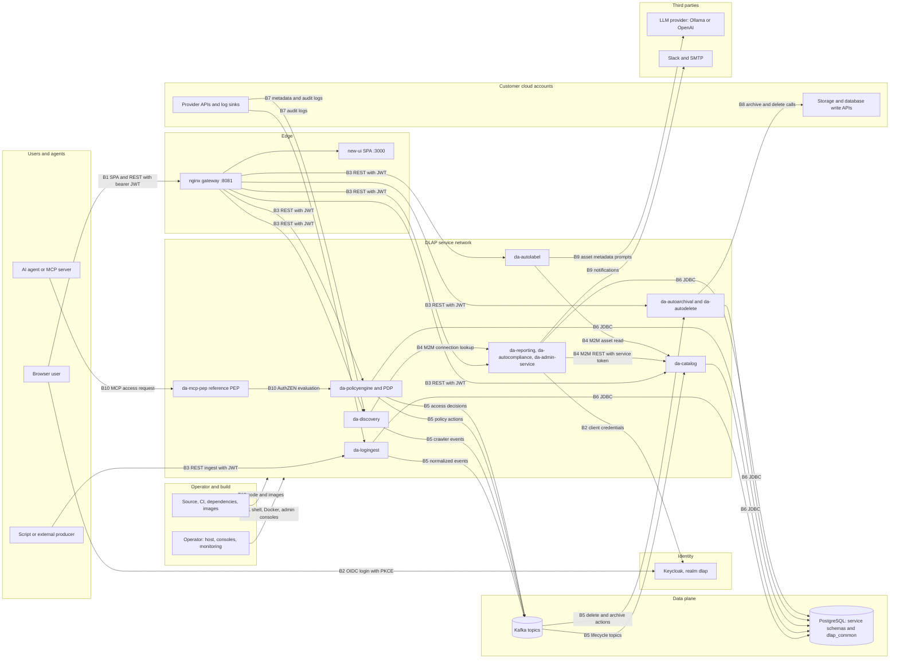
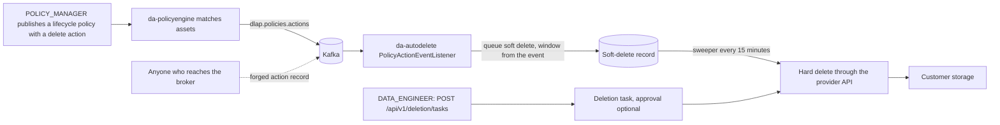

<!--
Licensed to the Apache Software Foundation (ASF) under one
or more contributor license agreements.  See the NOTICE file
distributed with this work for additional information
regarding copyright ownership.  The ASF licenses this file
to you under the Apache License, Version 2.0 (the
"License"); you may not use this file except in compliance
with the License.  You may obtain a copy of the License at

  http://www.apache.org/licenses/LICENSE-2.0

Unless required by applicable law or agreed to in writing,
software distributed under the License is distributed on an
"AS IS" BASIS, WITHOUT WARRANTIES OR CONDITIONS OF ANY
KIND, either express or implied.  See the License for the
specific language governing permissions and limitations
under the License.
-->

# DLAP threat model

**Method:** STRIDE per trust boundary, over the data-flow diagram in section 3.
**Rated for:** the read-only pilot (M3) and self-hosted production (M4) in
[deployment-models.md](deployment-models.md) section 4. Section 7 covers the other models.
**Code facts:** cited at `feature/deployment` commit `de3277de`, the head after wave 2B (UI
`490a7b6`; `App.tsx` lines are read at `6d17973`, which adds the demo banner frame). The first
version of this model read `7cc841a` (UI `12eb044`); after wave 2A and again after wave 2B the
rows that merged packages touch were read again, and every other cited line in a file that changed
was moved to its new number or confirmed unchanged. A Disposition that starts with "Mitigated"
names the merge commit of each package that landed. Line numbers move; a fact holds until the
package named against it lands.
**Used by:** the pen-test scope (SEC-09), the SOC 2 risk assessment and control map (CERT-02),
the CAIQ answer bank (CERT-01) and [../../SECURITY.md](../../SECURITY.md).

Package IDs (SEC-06, APPR-01 and so on) are the hardening work packages. Section 6 lists every
package this document names, with its gate and its state at `de3277de`.

## 1. Summary

DLAP reads a customer's cloud metadata and audit logs, decides what is stale, and can archive or
delete it. The two things an attacker wants most are therefore **the customer's data** (destroy
it through DLAP, or read it through DLAP's identities) and **DLAP's evidence** (forge or hide the
log events that drive decisions). Most high-severity rows below are one of those two.

Open high-severity threats at `de3277de`, in the order to close them:

1. **Unauthenticated Kafka drives real deletes.** Any client that reaches the broker can publish a
   delete action with a zero-day window, and the sweeper performs the real cloud delete (B5-S1,
   B5-T1). Closed by SEC-06 (SASL_SSL, ACLs), APPR-01 and RET-02 (approvals, window floor).
   The read-only pilot overlay leaves the archive and delete services out and binds every port
   to loopback (DEP-01, merged).
2. **One person can delete.** A lifecycle policy, or a DATA_ENGINEER task with an override,
   deletes without a second person, and an approver can approve their own task (B8-E1).
   Closed by APPR-01, RET-02 and RET-03.
3. **Missing logs look like no activity.** Partial read logging can make live data look unread
   (B7-I1), and data of unknown age passes a deny-if-stale access policy (B10-T2). Closed by
   POL-01 and COV-01.
4. **Forged evidence.** REST ingest lets a DATA_ENGINEER post events that look like provider logs
   (B7-S2), and the planned file transports will read logs that anyone with write access to the
   sink bucket can plant (B7-S1). Closed by LOG-02, POL-01, COV-01, IAM-03, CT-01 and GCP-01,
   with the contract gap in Q-185. LOG-02bc (merged) marks REST pushes on the registry pipeline
   with their binding and `source_format`, but that pipeline is off by default and the origin is
   unchanged (Q-223).
5. **Code execution in consumers.** `trusted.packages=*` and class-name type info on Kafka
   (B5-E1). Closed by SEC-03. The MVEL path into the policy engine (B3-E3) is closed (SEC-01,
   SEC-04).
6. **Identity defaults.** Seeded users with a known password, a default Keycloak admin
   password, Keycloak 23, no MFA, and one M2M client secret shared by eight services
   (B2-S1 to B2-S6). Closed by IAM-02 and SEC-05; per-service clients have no package yet
   (Q-184). The demo edge never proxies the Keycloak admin console and its `up.sh` refuses the
   default admin password (DEMO-01, merged).
7. **No transport security.** Every hop is plain HTTP or PLAINTEXT, and in the quickstart every
   infrastructure port is published on all host interfaces (B1-T1, B11-E1). Closed by SEC-06;
   the pilot overlay already binds the ports to loopback (DEP-01, merged), and the demo edge
   terminates TLS and publishes only ports 80 and 443 (DEMO-01, merged).

Wave 1 closed four classes: MVEL below ROLE_ADMIN (SEC-01), committed key material (SEC-02),
self-registration and the mock sign-up (IAM-01, UI-02), and handlers without named roles plus
CSV formula injection (RBAC-01).

Wave 2A closed or reduced five more: code execution through MVEL and regex denial of service
(SEC-04), replayed or reordered catalog events and wall-clock times (CAT-02a, QA-01), secrets in
new commits (CI-02a), a wrong provider or type for a discovered asset (DISC-02, CAT-02a), and
the pilot's exposure (DEP-01: loopback-only ports, memory limits, no archive or delete service by
default).

Wave 2B closed or reduced four more: the metrics and health detail of `da-discovery` (OBS-01),
the wall-clock time in the catalog's asset API (CAT-02b), delete and archive paths that parsed
locations by hand (ID-02), and, for the hosted demo only, the edge (DEMO-01: TLS, security
headers, request and body limits, an admin console that is never proxied, loopback-only Keycloak).
LOG-02bc built the registry ingest path, but it is off by default, so B6-I3, B7-D1 and B7-S2 stay
open.

Counts: 80 threats over 12 boundaries. Severity: 24 High, 37 Medium, 19 Low. Each threat names
the package that closes it, an accepted risk from section 5, or both.

State at `de3277de`, read from the first words of each Disposition:

| State | Rows | High | Medium | Low | Threats |
|---|---|---|---|---|---|
| Mitigated | 10 | 1 | 3 | 6 | B1-D1, B1-I2, B3-D1, B3-E1, B3-E3, B3-I1, B10-D1, B11-D1, B12-I1, B12-T1 |
| Mitigated in part | 14 | 6 | 7 | 1 | B1-I1, B1-T1, B2-S2, B2-T1, B3-D2, B5-S1, B5-T1, B5-T3, B6-S1, B7-T2, B8-T1, B11-E1, B12-I2, B12-T2 |
| Open | 56 | 17 | 27 | 12 | every other row, including rows that wait for the founder to accept a risk (Q-193) |

Since `7cc841a`, two rows moved to mitigated (B3-D1, B11-D1), nine to mitigated in part (B5-S1,
B5-T1, B5-T3, B6-S1, B7-T2, B8-T1, B11-E1, B12-I2, B12-T2), and two that were mitigated only
below ROLE_ADMIN or for the burned key were completed (B3-E3, B12-I1). For B11-D1, B5-S1, B5-T1,
B6-S1 and B11-E1 the state describes the pilot overlay; the quickstart is unchanged (AR-01).

Since `ef243754`, two rows moved to mitigated (B1-D1, B3-I1) and four to mitigated in part (B1-I1,
B1-T1, B2-S2, B3-D2). Of these, B1-D1, B1-I1, B1-T1, B2-S2 and B3-D2 describe the hosted demo
overlay (M2, DEMO-01); the quickstart gateway and the pilot are unchanged (AR-01, AR-10). B7-T2,
B8-T1 and B11-E1 stay in part with their residual brought forward. B6-I3, B7-D1 and B7-S2 stay open
on purpose: the controls LOG-02bc built run only with `dlap.logingest.pipeline=registry`, the
default is `legacy`, and no compose file or overlay selects the registry (Q-280). They move to
"Mitigated in part" when the default flips or a deployment sets it.

## 2. Scope, assumptions, method

### 2.1 In scope

- The ten `da-*` services, `da-mcp-pep`, `da-protos`, `da-llm-client` and the `new-ui` SPA.
- The canonical quickstart under `deployment/environments/dev/` and the realm
  `deployment/platform/keycloak/keycloak-import/dlap-realm.json`, as the base that the demo
  and pilot overlays build on.
- The build and release path: this repository, CI, dependencies and container images.

### 2.2 Assumptions (trusted)

- Cloud provider APIs authenticate DLAP correctly and return genuine provider logs over TLS.
- The host OS, the container runtime or Kubernetes node, and anyone with root or Docker-socket
  access on them, are inside the trust base (AR-05).
- The operator keeps secrets in a secret store and follows `deployment/PRODUCTION.md`.
- The customer's identity provider, once federated (IAM-02), authenticates users correctly.

### 2.3 Out of scope

- Vulnerabilities inside third-party products (Keycloak, Kafka, PostgreSQL, the JDK). This
  model does track the versions DLAP pins and flags them when they are out of date.
- Compromise of the cloud provider itself, and physical attacks.
- The customer-side execution of the zero-access scan kit (section 7 notes the kit).

### 2.4 Assets

| ID | Asset | Why it matters |
|---|---|---|
| A1 | Customer cloud data reachable by archive and delete | Loss is irreversible once the soft-delete window ends. |
| A2 | Cloud identities DLAP runs as, and stored cloud credentials | They reach A1 and everything else the identity can read. |
| A3 | Audit-log events and their raw records | They name principals, IPs and user agents (personal data), and they are DLAP's evidence. |
| A4 | Catalog state: assets, times, size, owners, labels, retention | Policies decide on it. Wrong state means wrong deletes or wrong access verdicts. |
| A5 | Policies, approvals and access verdicts | They define what DLAP may do and what agents may read. |
| A6 | DLAP's own audit trail | Non-repudiation for every destructive or governance change. |
| A7 | Platform secrets | `DLAP_ENCRYPTION_KEY`, the `dlap-backend` client secret, database passwords, the LLM API key, the Keycloak admin password. |
| A8 | Ingest availability | A silent gap in log ingest makes data look unread. |

### 2.5 Threat actors

| ID | Actor | Starting access |
|---|---|---|
| T1 | Network attacker | Reaches the host or the container network, no credentials. |
| T2 | Low-privilege user | A realm account with a Reader-tier role (VIEWER, AUDITOR, DATA_ANALYST). |
| T3 | Privileged insider | POLICY_MANAGER, DATA_ENGINEER, CDO or ADMIN, acting alone. |
| T4 | Compromised component | Code execution in one DLAP service or container. |
| T5 | Cloud-side actor | Can create or name resources in the customer's account, or write a log-sink bucket. |
| T6 | Third party | An LLM provider or notification service DLAP sends data to. |
| T7 | Supply chain | A malicious dependency, image, CI action or commit. |
| T8 | DLAP operator | DLAP staff with operational access (M5 only, deployment-models.md section 5.6). |

### 2.6 Rating and disposition

- **High:** a plausible actor from 2.5 destroys or alters customer data (A1), gains code
  execution, takes over an identity, or forges the evidence that destructive decisions use.
- **Medium:** discloses personal data or secrets, or corrupts DLAP state without a direct path
  to A1.
- **Low:** needs privileged access for little gain, or the impact is contained.
- **Disposition:** the package or packages that close the threat. "Mitigated (PKG, commit)"
  means the package has landed, at that merge commit, and the row records the residual.
  "Mitigated in part" means a named package landed and another is still open.
  `AR-nn` is an accepted risk (section 5).
  Where a needed control is in no package's acceptance list yet, the row says so and names the
  open question that asks for it.
- **Gate:** when the threat must be closed. G0 is before outreach and the hosted demo, G1 before
  the first read-only pilot, G2 before an archive or delete pilot, GA before general
  availability. `-aws`, `-azure` and `-databricks` limit a gate to a pilot on that platform.
  "n/a" marks a row closed by an accepted risk alone.

## 3. Data flows and trust boundaries

### 3.1 Data-flow diagram

Edges are labelled with the boundary they cross (section 3.2).

Most threats in section 4 converge on the destructive path:

Facts behind the second diagram: `PolicyDsl.java:146-147` (approval and dry run default off),
`da-autodelete/.../kafka/PolicyActionEventListener.java:53-95`,
`DeletionServiceImpl.java:77-78,84,108-110,171,233-248`, `DeletionTaskController.java:50-51`,
`DeletionTaskServiceImpl.java:144-149`, and `dlap.autodelete.dry-run-cloud-delete=false` at
`da-autodelete/src/main/resources/application.properties:108`.

### 3.2 Trust boundaries

| ID | Boundary | What crosses it | Authentication at `de3277de` |
|---|---|---|---|
| B1 | Browser to edge (gateway and SPA) | SPA assets, REST calls with a bearer JWT | None at the edge; plain HTTP on 8081 (the demo overlay puts a TLS edge in front, DEMO-01) |
| B2 | Clients to Keycloak | OIDC login, client-credentials grants, the admin console | Realm passwords, one shared client secret, the admin password |
| B3 | Callers to service REST APIs | Every API request | JWT signature and expiry; issuer and audience off by default; `@PreAuthorize` per handler; `/actuator/health` is anonymous on every service (OBS-01) |
| B4 | Service to service REST | M2M reads and writes | One shared service-account token, plain HTTP |
| B5 | Services to Kafka | Log events, lifecycle events, policy actions, access decisions | None (PLAINTEXT, no ACLs) |
| B6 | Services to PostgreSQL | All persistent state | One password per service, no TLS |
| B7 | Customer cloud to DLAP | Resource metadata, audit logs, REST-ingested events | Provider TLS plus the process identity; JWT for REST ingest |
| B8 | DLAP to customer cloud | Archive and delete calls | The process identity |
| B9 | DLAP to third parties | Prompts with asset metadata, notifications | Provider API key or token |
| B10 | Agents to PEP to PDP | Access requests and verdicts | None at the PEP; service token at the PDP |
| B11 | Operator to host and consoles | Shell, Docker, Keycloak and Grafana consoles, metrics | Dev defaults |
| B12 | Source and supply chain to running code | Commits, dependencies, actions, images | GitHub accounts, DCO sign-off |

## 4. Threats by trust boundary

Columns: ID (boundary, STRIDE letter, number), threat, evidence at `de3277de`, severity (H, M,
L), disposition, gate. A path is shortened to its file name where the module makes it unique.
Short names: `dlap-realm.json` is `deployment/platform/keycloak/keycloak-import/dlap-realm.json`;
`docker-compose.yml` and `docker-compose.microservices.yml` are the quickstart pair under
`deployment/environments/dev/`; `nginx.conf` is `deployment/environments/dev/gateway/nginx.conf`;
`App.tsx` is `new-ui/frontend/src/App.tsx` in the UI repository at `6d17973`.

### 4.1 B1 Browser to edge

| ID | Threat | Evidence | Sev | Disposition | Gate |
|---|---|---|---|---|---|
| B1-S1 | Authorization codes or logout redirects sent to an attacker-chosen path: `dlap-ui` accepts wildcard paths on six localhost origins and any post-logout redirect. A deployment that adds its public origin the same way inherits it. PKCE S256 limits what a stolen code is worth. | `dlap-realm.json:313-328,344`; `new-ui/frontend/src/App.tsx:149-152` | L | DEMO-02 (exact redirect URIs), IAM-02 (production realm template) | G0 demo, G1 |
| B1-T1 | Tokens and data in clear: the gateway listens on plain HTTP, so anyone on the path reads or alters bearer tokens and responses. | `deployment/environments/dev/gateway/nginx.conf:40`; SECURITY.md transport table; `deployment/environments/demo/caddy/Caddyfile:61-67,160,174` (TLS for the app and Keycloak hosts); tests `test-demo.sh` C-01 (over TLS) and C-23 (no plain-HTTP route) | H | Mitigated in part (DEMO-01, `34456295`) for the hosted demo: Caddy terminates TLS on both hosts and the app host has no plain-HTTP route. The quickstart gateway and the pilot stay on plain HTTP, and the hops behind the demo edge stay plain HTTP on an internal network (B4-S1). Open: SEC-06 (TLS on every hop, pilot TLS overlay) | G0 demo, G1 |
| B1-I1 | No browser security headers: no Content-Security-Policy, HSTS, frame-ancestors or Referrer-Policy, so clickjacking works and a future XSS meets no second line of defence. Today React escapes output, `new-ui/frontend/src` has no `dangerouslySetInnerHTML`, and keycloak-js keeps tokens in memory. | `nginx.conf` has no `add_header`; `App.tsx:149-152`; `deployment/environments/demo/caddy/Caddyfile:71-76,86-91` (HSTS, nosniff, Referrer-Policy, Permissions-Policy, X-Frame-Options and a CSP with `frame-ancestors 'none'`); tests `test-demo.sh` N-18, C-08, C-09, C-10 | M | Mitigated in part (DEMO-01, `34456295`) for the hosted demo: Caddy sets one authoritative copy of each header on the app and Keycloak hosts (Q-190). The quickstart gateway still sends none. Open: SEC-06 (headers on the pilot TLS entry point) | G1 |
| B1-I2 | Spreadsheet formula injection through CSV exports: asset names come from customer clouds. | `da-reporting/.../export/CsvWriter.java:67,98-103` escapes cells starting with `= + - @ TAB CR` | L | Mitigated (RBAC-01, `f2ab2e7c`); RPT-01 must reuse `CsvWriter` | G1 |
| B1-D1 | Request floods and large bodies: no rate limit at the edge and a 25 MB body limit. | `nginx.conf:20`; `deployment/environments/demo/gateway/nginx.demo.conf:68,77-84,126,172-189` (256 KB body, `limit_req` and `limit_conn` per address); `Caddyfile:102-103,177-178` (256 KB on the app host, 64 KB on the Keycloak host); tests `test-demo.sh` N-13, N-14, C-13 | M | Mitigated (DEMO-01, `34456295`) for the demo overlay: the gateway allows 15 API requests a second per address with a burst of 60, 2 a second on the AuthZEN route and 40 connections, and refuses a body over 256 KB (413). Only the AuthZEN limit has a named 429 test; the API zone is configured and not exercised by a test. The quickstart gateway and the pilot keep 25 MB and no limit (AR-01, AR-10) | G0 demo |

### 4.2 B2 Clients to Keycloak

| ID | Threat | Evidence | Sev | Disposition | Gate |
|---|---|---|---|---|---|
| B2-S1 | Known passwords: five seeded users, including `admin` with ROLE_ADMIN, have the non-temporary password `Password123!`. Importing this realm anywhere reachable hands out every tier. They stay in the dev realm on purpose, for the harnesses. | `dlap-realm.json:457-603`; the orphan copy `deployment/environments/dev/docker/keycloak/realm-config/dlap-realm.json` (Q-069) | H | IAM-02 (production template, no seeded users, orphan copies deleted), DEMO-02 (demo realm, no seeded users); AR-01 for the quickstart | G0 demo, G1 |
| B2-S2 | Keycloak admin takeover: the master admin password defaults to `admin`, and ports 8180 and 8443 are published on all host interfaces. | `deployment/environments/dev/docker-compose.yml:107,118-120`; `deployment/environments/demo/docker-compose.demo.yml:119-120` (Keycloak on loopback only, no 8443); `Caddyfile:183-201` (realm, resource and robots paths only); `deployment/environments/demo/up.sh:129` (refuses an unset, placeholder or default `KEYCLOAK_ADMIN_PASSWORD`); `demo/verify.sh:137-153` (V03); tests `test-demo.sh` C-05, C-06, C-07 | H | Mitigated in part (DEMO-01, `34456295`) for the hosted demo: the edge never proxies the admin console, the admin API, the master realm, metrics or health (17 paths with case and encoding variants), and `up.sh` refuses the default admin password. The quickstart still defaults to `admin` on every interface. Open: SEC-05 (admin passwords from env), IAM-02 (production mode, admin console on its own hostname); whether the pilot overlay earns a flip is Q-258 | G0 demo, G1 |
| B2-S3 | Outdated identity server: Keycloak 23.0.1 in `start-dev` on an embedded file database, with the `scripts` feature on. CVE-2026-18963 (password reset) is fixed in 26.7.2; reset password is off in the realm, which narrows that flaw [unverified]. | `docker-compose.yml:98,100,105,108`; `dlap-realm.json:38` | H | IAM-02 (patched 26.x, production mode, scripts off), DEMO-02 (patched 26.x) | G0 demo, G1 |
| B2-S4 | Outside accounts through social brokers: Google and Facebook brokers are enabled with `trustEmail` true, and IdP mappers grant ROLE_DATA_ENGINEER on an email claim match. Their client IDs are placeholders, so they do nothing until an operator fills them in; from then on first-broker login creates accounts even with registration off [unverified]. | `dlap-realm.json:612-655,667-697` | M | IAM-02 (brokers removed; Okta and Entra documented) | G1 |
| B2-S5 | A phished password is enough: a TOTP policy exists, but no role requires it and every seeded user has `totp` false. | `dlap-realm.json:292-298,463` | H | IAM-02 (MFA for ADMIN, CDO, POLICY_MANAGER and approvers), DEMO-02 (OTP for ADMIN) | G0 demo, G1 |
| B2-S6 | One M2M identity for everything: the confidential client `dlap-backend` defaults to the secret `change-me-dev-only`, allows the password grant, and its service account holds ROLE_SERVICE_ACCOUNT. Eight of the ten services (all but da-catalog and da-logingest) receive the same secret, so one leak or one compromised service (T4) acts as all of them on every allow-listed endpoint (ADR-0034). | `dlap-realm.json:374-391,604-609`; `docker-compose.microservices.yml:128,230,264,354,392,423,518,549` | H | SEC-05 (boot guard rejects `change-me-dev-only`; secrets out of `SPRING_APPLICATION_JSON`), IAM-02; one client per service is in no package (Q-184) | G1 |
| B2-T1 | Long-lived offline tokens: IAM-01 removed `offline_access` from the default roles, but the import re-adds it (Q-067) and seeded users hold it explicitly; an offline token outlives the SSO session. | `dlap-realm.json:133-139,476-480` | M | Mitigated in part (IAM-01, `42c02a95`); IAM-02 (Q-067) | G1 |
| B2-R1 | No identity audit: the realm enables neither login events nor admin events, so failed logins, role grants and client changes leave no record. | no `eventsEnabled` or `adminEventsEnabled` key in `dlap-realm.json` (Keycloak default: off) | M | AUD-02b (Keycloak event poller into the audit chain); IAM-02 should enable events in the production template (Q-184) | GA |
| B2-D1 | Lockout of a named user: brute-force protection locks an account for up to 15 minutes after failures, which anyone who knows the username can trigger. | `dlap-realm.json:40-44` | L | AR-03 | n/a |
| B2-I1 | Identity traffic in clear: services and browsers reach Keycloak over HTTP, and `sslRequired` is `external`. | `dlap-realm.json:31`; SECURITY.md transport table | M | SEC-06, IAM-02 (https issuer) | G1 |

### 4.3 B3 Callers to service REST APIs

| ID | Threat | Evidence | Sev | Disposition | Gate |
|---|---|---|---|---|---|
| B3-S1 | Tokens minted for any client of the realm are accepted: issuer and audience validation default to off in every resource server, and production turns them on through env only. | `da-catalog/.../config/SecurityConfiguration.java:79-97,135-143,216-228,241-248`; the same two flags in the eight other resource-server `SecurityConfiguration.java` files and in `da-discovery/.../crawler/config/CrawlerSecurityConfiguration.java:80-87`; `deployment/PRODUCTION.md` section 4; Q-014 (resolved 2026-07-01 by choosing signature-only validation for dev, `docs/OPEN_QUESTIONS.md:465-468`) | M | SEC-06 (issuer and audience checked), DEMO-02 (issuer through env: since OBS-01, `7ce5c253`, `dlap.security.jwt.expected-issuer` takes a comma list in every service; DEMO-02 still has to set it); SEC-05 should refuse `prod` with validation off (Q-186) | G1 |
| B3-E1 | A handler without a role check: closed by a reflection test in all 11 services that fails on a missing or `isAuthenticated()`-only rule. Residual: the test allowlist, and notification endpoints that keep `isAuthenticated()` with an owner check. | `*/src/test/.../security/HandlerAuthorizationCoverageTest.java` (11 files); `da-reporting/.../controller/NotificationController.java:63-64,92-97,106-111` | L | Mitigated (RBAC-01, `f2ab2e7c`). QA-01 (`15414e0f`) removed no entry: the lists were already down to `NotificationController` in da-reporting and `McpPepController` in da-mcp-pep (Q-071, B10-S1) | G0 |
| B3-E2 | No data scoping: any role that can read the catalog reads every asset, report and export in the deployment, and destructive endpoints are not limited to an account or project. | ADR-0032 roles are global; no scope claim in `dlap-realm.json` | M | RBAC-02 (destructive actions scoped, G2), RBAC-03 (reads filtered through the PDP, GA) | G2 |
| B3-E3 | Remote code execution through MVEL: policy and subscription rule conditions were MVEL expressions, which compile and run as code in the policy-engine JVM, so an admin token (B2-S1, B2-S5) was code execution with that service's database password and the shared client secret. SEC-01 limited authoring to ROLE_ADMIN; rules stored before it could remain (Q-056). | `da-policyengine/build.gradle.kts:28-47` (no MVEL or Easy Rules; resolution ban on `org.mvel` and `org.jeasy`); `PolicyEvaluationService.java:71-75,140-152` (a policy runs only as its DSL document); `EventSubscriptionService.java:447-452` (`rules[]` refused); `V5__retire_mvel_rules.sql`; `scripts/ci-guards/pre/no-mvel.sh`; tests `NoMvelOnClasspathTest`, `RetireMvelRulesMigrationTest`, `PolicyServiceLegacyRulesTest`, `EventSubscriptionServiceTest` | H | Mitigated (SEC-01, `58cf7838`; SEC-04, `1b797c78`): the engine is off the service's classpath and the build fails if it returns; `rules[]` is refused with 400 for every role; V5 archived every stored condition to `retired_mvel_rules` and disabled the policies and subscriptions that had one (Q-056). Residual: `no-mvel.sh --resolved`, which also catches a transitive dependency in another module, runs in no CI job (Q-152) | G1 |
| B3-D1 | Regex denial of service: the DSL `nameMatches` clause compiled a caller-supplied `java.util.regex` pattern with no length or time bound, on every evaluation. | `PolicyDslEvaluator.java:93,130-145`; `BoundedRegex.java:44,62-76`; `PolicyService.java:198,632,658-690`; tests `BoundedRegexTest`, `PolicyDslEvaluatorBoundedRegexTest` | M | Mitigated (SEC-04, `1b797c78`): `nameMatches` runs on RE2/J, which matches in linear time, with a 256-character cap that is checked again when a policy is saved, enabled or drafted; an oversize or non-RE2 pattern fails closed (no match) | G1 |
| B3-D2 | Unbounded requests: no rate limit or quota on the ten services (only `da-mcp-pep` has one), and the page-size cap exists in three services only (Q-029). | `da-mcp-pep/.../RateLimitConfiguration.java`; `spring.data.web.pageable.max-page-size` only in the catalog, policy-engine and reporting `application.properties` (lines 118, 81, 132); `deployment/environments/demo/gateway/nginx.demo.conf:77-84,172-189`; test `test-demo.sh` N-14 | M | Mitigated in part (DEMO-01, `34456295`): the demo gateway limits requests and connections per address (B1-D1). The services are unchanged. Open: SEC-03 (page-size cap everywhere, DTO validation); AR-10 for the pilot | G1 |
| B3-T1 | Unvalidated input on admin configuration DTOs (Q-027): oversized or malformed values reach services and stored configuration. | Q-027 names `CreateJobRequest`, `DeletionConfigDTO`, `MLConfigRequest` | L | SEC-03 (DTO validation) | G1 |
| B3-T2 | Cross-origin calls with credentials: CORS allows credentials for the configured origin patterns, and the discovery test configuration uses `*` with credentials (Q-028). Bearer tokens are not cookies, which limits the impact. | `da-catalog/.../config/SecurityConfiguration.java:255-267` | L | SEC-03 (concrete origins in the test config) | G1 |
| B3-I1 | Metrics and health details without authentication: `da-discovery` served `/management/prometheus` to anyone and always showed health details. | `CrawlerSecurityConfiguration.java:117-130` (of the actuator and management paths only the health paths are `permitAll`; `/management/**` needs ROLE_ADMIN; anything unmatched is denied); `da-discovery/.../config/SecurityConfiguration.java:57-67` (`prometheusScrapeFilterChain`: the prometheus endpoint is open only on a separate management port); `da-discovery/src/main/resources/config/application.yml:74` (`show-details: when_authorized`); tests `ActuatorExposureTest` in `da-discovery` (`healthProbesArePublicOnTheManagementPort`, `prometheusIsNotOpenOnTheApplicationPortWhenThereIsAManagementPort`, `everythingElseNeedsATokenOnBothPortsWithAManagementPort`, `withoutAManagementPortOnlyHealthIsPublic`) | L | Mitigated (OBS-01, `7ce5c253`): the health paths are the only open actuator paths on the application port, `/actuator/prometheus` is open without a token only on the management port, and `/management/**` and every other actuator path need a token. The effective health detail was read by loading the service's own `application.properties` and `config/application*.yml` with Spring Boot 3.2.5 in a scratch harness (not a committed test): `when_authorized` under `prod`, although `application.properties:57` still says `always`, because `config/` overrides the classpath root. Residual: the default profile is `dev` and shows health detail to every caller (`config/application-dev.yml:48`, Q-242; the dev compose overrides it); the management port has no token by design, so it must not be published or reachable by anyone but Prometheus (Q-250, DEP-02 NetworkPolicy); the `prod` profile switches the scrape off (Q-240) and the pilot overlay sets no management port (Q-245) | G1 |
| B3-I2 | API descriptions are public: `/v3/api-docs` and Swagger UI are `permitAll` on ten of the eleven services (`da-policyengine` has no such rule and asks for a token; `da-mcp-pep` permits every path), which helps an attacker map the surface. | `da-catalog/.../config/SecurityConfiguration.java:111`; the same matcher in the other `SecurityConfiguration.java` files and in `CrawlerSecurityConfiguration.java:111-115`; `da-mcp-pep/.../SecurityConfiguration.java:65` | L | AR-02 | n/a |

### 4.4 B4 Service to service

| ID | Threat | Evidence | Sev | Disposition | Gate |
|---|---|---|---|---|---|
| B4-S1 | Token theft on internal hops: services call each other over plain HTTP with the shared service token, so a foothold on the network path (T4) replays it. | `docker-compose.microservices.yml:128` (`http://da-catalog:8080` and a token URI over HTTP) | M | SEC-06 (every hop encrypted) | G1 |
| B4-E1 | Confused deputy: a service calls another with its own service token, not the user's, so the callee cannot apply the user's scope. Harmless while reads are unscoped (B3-E2); a bypass once RBAC-03 scopes them. | ADR-0034 (token attached by the shared Feign interceptor) | L | RBAC-03 (user context or scoped M2M on scoped reads) | GA |
| B4-I1 | Secrets in free-form connection parameters: GET never returns the stored secret, and discovery receives only non-secret scope keys. But `connectionParameters` is a free-form map documented as able to hold keys such as `accessKey`, and it is returned in clear to ADMIN and, since WAVE1-FU (`c5995f39`), to ROLE_SERVICE_ACCOUNT on the two read endpoints. | `CloudConnectionDTO.java:57-61`; `CloudConnectionMapper.java:46`; `da-discovery/.../client/admin/HttpAdminServiceClient.java:53-54,180-198`; `CloudConnectionController.java:60-61,69-70` (reads: ADMIN and SERVICE_ACCOUNT; create, update, delete and test: ADMIN); test `CloudConnectionControllerServiceAccountTest` | M | SEC-10 (credentials only through the CredentialProvider SPI); rejecting secret-like keys is not in its acceptance list (Q-189) | G1 |

### 4.5 B5 Services to Kafka

| ID | Threat | Evidence | Sev | Disposition | Gate |
|---|---|---|---|---|---|
| B5-S1 | Anyone can produce and consume: every listener is PLAINTEXT with no SASL and no ACLs, and 9092 and 9093 are published on all host interfaces. The advertised listener is `localhost`, which a remote client bypasses with a local port forward. | `docker-compose.yml:137-139,145-149`; `docker-compose.pilot.base.yml:112` | H | Mitigated in part (DEP-01, `39887c61`): the pilot overlay publishes Kafka on 127.0.0.1 only, checked by `verify.sh`; the quickstart still binds every interface (AR-01). Open: SEC-06 (SASL_SSL with SCRAM, ACLs per service principal), KAFKA-01 (one factory that honours the security settings) | G1 |
| B5-T1 | Forged destructive actions: a record on `dlap.policies.actions` with action type DELETE and no `requireApproval` queues a soft delete. `actionParameters.softDeleteWindowDays` sets the window with no floor, so 0 schedules the hard delete for the next 15-minute sweep, and the sweep deletes for real by default. Archive follows the same pattern. | `da-autodelete/.../kafka/PolicyActionEventListener.java:53-95`; `DeletionServiceImpl.java:77-78,108-110,171,233-248`; `da-autodelete/src/main/resources/application.properties:108`; `da-autoarchival/.../kafka/consumer/PolicyActionEventListener.java:74-90`; `docker-compose.pilot.base.yml:356,363-364,374,382` | H | Mitigated in part (DEP-01, `39887c61`): the pilot overlay keeps `da-autoarchival` and `da-autodelete` behind the compose profile `actions`, and with it on deletes are dry runs and archival is mocked. Open for G2: SEC-06 (only the policy engine may produce actions), APPR-01 and RET-02 (approvals, window floor), RET-03, PILOT-01 | G1 by exclusion, G2 to enable |
| B5-T2 | Forged evidence on the spine: records on `dlap.log.event.normalized` and `dlap.discovery.asset.*` change catalog status, last read and owner, which policies then act on. | `docs/architecture/overview.md` section 3 | H | SEC-06 (ACLs per producer), CAT-02a (`ecbf9246`, landed: dedup through `processed_event` and event-time ordering limit replays, not new forged events) | G1 |
| B5-E1 | Code execution through deserialization: seven services trust every package named in JSON type headers, and two discovery event types use class-name type info, so a producer chooses the class Jackson builds. With a gadget on the classpath that is code execution in the consumer. | `spring.json.trusted.packages=*` in the `application.properties` of da-admin-service (line 67), da-autoarchival (69), da-autocompliance (66), da-autodelete (70), da-autolabel (88), da-logingest (64) and da-reporting (88); `LogEvent.java:40`; `ResourceEvent.java:42` | H | SEC-03 (explicit type mappings, `Id.NAME` with `@JsonSubTypes`) | G1 |
| B5-I1 | Topic contents readable: events carry principals, caller IPs and user agents, and every access verdict. | `log_event.proto:356-357`; `DlapConstants.java:286` (`dlap.access.decision`) | M | SEC-06 (TLS and read ACLs) | G1 |
| B5-R1 | No producer identity: a consumer cannot tell which service wrote a record, and records are not signed. | broker listeners at `docker-compose.yml:145-149` carry no authentication | M | SEC-06 (ACLs fix the producer set per topic), AUD-01 (governance events in a hash chain) | G2 |
| B5-T3 | Replay and reordering: at-least-once delivery and replays could apply an old event after a newer one. | `AssetEventApplier.java:236-239,307` (the claim of `(consumer, event key, asset)` is part of the record's transaction); `ProcessedEventStore.java:48-64,97`; `V3__processed_event_and_usage_daily.sql:31-37`; `AssetStateRules.java:37-38,203-205` (a status change applies only when `eventTime >= lifecycleEventTime`); tests `AssetStateRulesTest`, `CatalogEventIngestContainerTest`; `docs/architecture/overview.md` section 3 (at-least-once delivery) | M | Mitigated in part (CAT-02a, `ecbf9246`) in `da-catalog`, the consumer that applies state from the spine; open: SPINE-01 (one encoding, awaited sends) | G1 |
| B5-D1 | Broker abuse and fragility: topic auto-create is on, one broker runs with replication factor 1, and a poison record lands in a dead-letter topic. | `docker-compose.yml:159`; `deployment/PRODUCTION.md:168-169` | M | SEC-03 (dead-letter partitions handled safely), HA-02 (auto-create off, RF 3) | G1, GA |

### 4.6 B6 Services to PostgreSQL

| ID | Threat | Evidence | Sev | Disposition | Gate |
|---|---|---|---|---|---|
| B6-S1 | Guessable database logins: each service user's password is `<db>_pass`, the superuser password defaults to `dlap`, and 5432 is published on all host interfaces. | `deployment/platform/database/init-scripts/00-create-multiple-databases.sh:58`; `da-catalog/src/main/resources/application.properties:34-35`; `docker-compose.yml:52,65-66`; `docker-compose.pilot.base.yml:60-61` | H | Mitigated in part (DEP-01, `39887c61`): the pilot overlay publishes 5432 on 127.0.0.1 only and `up.sh` refuses the default superuser password; the per-service `<db>_pass` passwords stay (Q-176). Open: SEC-05 (boot guard; its default list lacks these passwords, Q-186) | G1 |
| B6-I1 | Database traffic in clear: JDBC URLs carry no `sslmode`. | `da-catalog/src/main/resources/application.properties:33,139` | M | SEC-06 (`sslmode=verify-full`) | G1 |
| B6-I2 | Personal data in the database log: `log_statement=all` writes every statement with its literals, including principals and IPs from log events. | `docker-compose.yml:91` | M | SEC-05 (`log_statement=ddl`) | G1 |
| B6-I3 | Personal data at rest: `log_events` keeps raw provider records with principals, IPs and user agents for 90 days by default, and DLAP configures no database, volume or backup encryption. | `da-logingest/src/main/resources/application.properties:119-122` (`retention-days` 90, whole months by ingest time, so a row lives 90 to about 121 days, Q-225); `LogIngestServiceImpl.java:132` (the legacy pipeline stores `raw_event` verbatim); `RegistryIngestService.java:191` and `PersistRaw.java:90` (on the registry pipeline a data event keeps its raw record only in quarantine by default); `BuiltinBindings.java:46,155` (the built-in REST and replay bindings keep `ALL`); `application.properties:100` (`dlap.logingest.pipeline` defaults to `legacy`); tests `FrozenRulesTest.rawRecordsOfDataEventsAreKeptOnlyInQuarantineByDefault`, `RegistryIngestServiceTest.theRestChannelKeepsTheRawRecordAndStampsTheRegistryColumns`, `RegistryIngestServiceTest.filtersDropEventsAndPersistRawFollowsTheBinding`; SECURITY.md at-rest section | M | LOG-03 (redacted, bounded quarantine; today a quarantined registry record is only logged, Q-228), the flip of the pipeline default (design B8 step 4.3), DR-01 (backup encryption and key escrow); AR-04 for volume encryption. LOG-02bc (`de60daf2`) built the `persist-raw` switch, but it runs only with `dlap.logingest.pipeline=registry`, which no compose file or overlay selects (the e2e compose forwards it with a `legacy` default, Q-280); the default pipeline, and the REST and replay bindings on the registry, still keep the raw record, so the row stays open | G1 |
| B6-T1 | A compromised service rewrites shared or historical state: services own their tables (Flyway runs as the runtime user) and hold write grants on `dlap_common`; `da_catalog_user` holds ALL PRIVILEGES there. | `01-create-schemas-and-users.sql:37-46`; deployment-models.md section 3 | M | AUD-01 (the database rejects UPDATE and DELETE on audit tables); AR-11 for owner roles | G2 |
| B6-R1 | Evidence can be erased: deletion audit rows are append-only by comment only, and policies are hard-deleted with only the last writer kept. | `DeletionAuditEntity.java:43`; `PolicyController.java:158-159`; `PolicyService.java:173,219` | H | AUD-01 (hash chain, signed checkpoints), AUD-02a (immutable policy versions, soft delete), RET-02 (chained deletion events) | G2 |
| B6-D1 | One database instance, a pool of 10 connections per service, no failover. | `da-catalog/src/main/resources/application.properties:38` | M | DR-01 (backups, RPO 15 minutes), DR-02 (restore drill), HA-02 (Postgres HA) | G1, GA |

### 4.7 B7 Customer cloud to DLAP (discovery and log ingest)

| ID | Threat | Evidence | Sev | Disposition | Gate |
|---|---|---|---|---|---|
| B7-S1 | Forged log files: the planned file transports read logs from storage in the customer's account (GCS sink shards, S3 trail files, Azure append blobs and inventory), so anyone who can write those buckets (T5) plants audit records. CT-01 routes the CloudTrail digest prefix but does not validate digests. | the GCP-01, CT-01 and AZ-01 package scopes; today only API transports exist (`GcpLogSource.java:576`, `CloudTrailLogSource.java:658-661`) | H | IAM-03 (sink buckets writable only by the provider's log writer), GCP-01, CT-01, AZ-01; digest validation is not in the CT-01 acceptance list (Q-187) | G1, G1-aws, G1-azure |
| B7-S2 | Fabricated events through REST ingest: ROLE_ADMIN or ROLE_DATA_ENGINEER can post any provider, principal, operation and target. The legacy pipeline sets no origin, and the Origin enum has no value for an API push, so these events cannot be told apart from provider logs. | `da-logingest/.../web/IngestController.java:101-102` (ROLE_ADMIN or ROLE_DATA_ENGINEER), `:108-117` (the registry branch); `docs/specs/log-event.md:58`; `log_event.proto:216-227`; test `RegistryIngestServiceTest.theRestChannelKeepsTheRawRecordAndStampsTheRegistryColumns` (binding `dlap-rest-aws`, `source_format` `DLAP_NORMALIZED_AWS/ingest-dto`, origin `ORIGIN_CLOUD_LOG`) | H | LOG-02 (REST ingest through the registry, with `source_format` DLAP_NORMALIZED), POL-01 and COV-01 (destructive evidence only from provider origins); the contract gap is Q-185 and Q-223. LOG-02bc (`de60daf2`) routes REST pushes through the registry and marks them with the binding and `source_format`, but only with `dlap.logingest.pipeline=registry` (default `legacy`), the origin stays `ORIGIN_CLOUD_LOG`, and nothing yet refuses destructive evidence from those bindings (Q-221), so the row stays open | G1 |
| B7-T1 | Attacker-chosen names: whoever may create a bucket or table chooses its name, description and tags. They flow to the UI (escaped by React), CSV (B1-I2), LLM prompts (B9-T1) and application logs, which print them raw, so CR and LF forge log lines. | `IngestController.java:105-107` logs the target ID | L | OBS-02 (structured JSON logs) | GA |
| B7-T2 | Wrong business time: a timestamp from the wall clock instead of the event moves "last read" and makes data look fresher or older than it is. | plan rule R6 (business time is event time); `AssetStateRules.java:31-33,203-205` (no clock read; an event older than the row's lifecycle time leaves it alone); `AssetService.java:180,226,709` (a `Clock` is injected and the processing time is `clock.instant()`; no `Instant.now()` is left in the file); test `AssetServiceActivityTest.asOfDefaultsToTheInjectedClockNotTheWallClock`; `scripts/ci-guards/pre/no-instant-now.sh` and `no-instant-now.allowlist` (the `AssetService` and `LogEventRetentionSweeper` entries are gone, `414adea9`); `PolicyDslEvaluator.java:182` still calls `Instant.now()` | M | Mitigated in part (CAT-02a, `ecbf9246`; QA-01, `15414e0f`; CAT-02b, `5b8e6dc4`): the catalog applies every event at its event time, its asset API and activity report take their time from an injected `Clock`, and no new bare `Instant.now()` can enter `da-*/src/main`. Open: 206 calls in 88 files stay under the ratchet, 20 files with 51 calls among them decide a business field (14 in `da-discovery`: the 13 crawlers fall back to the wall clock for `updatedAt` or the creation time, and `AWSLoggingAdapter` for the event time; 3 in `da-policyengine`, `PolicyDslEvaluator.java:182` for POL-01 among them; 3 in `da-reporting` for RPT-03) | G1 |
| B7-D1 | Parser exhaustion: oversized, deeply nested or compressed records (gzip trail files, sink shards) exhaust memory or CPU in `da-logingest`. Unknown major versions are quarantined by design. | ADR-0045 (`on-mismatch` quarantine); `DefaultParserRegistry.java:134-136` (oversize check first); `docs/specs/log-parser-contract.md:71`; `RegistryIngestService.java:174-191` (REST and replay records go through the registry); `BuiltinBindings.java:155` (default `maxRecordBytes`); test `DefaultParserRegistryTest.anOversizeRecordIsRefusedBeforeDetection` | M | LOG-02 (file transports), LOG-03 (bounded quarantine), FIX-03 (drift mutator). LOG-02bc (`de60daf2`) is the first live caller of the per-record size limit (`maxRecordBytes`, default 1 MiB, quarantined as OVERSIZE_RECORD), but only on `dlap.logingest.pipeline=registry` (default `legacy`); the transport SPI exists and no file transport does, and decompressed-size and depth bounds are in no acceptance list (Q-188), so the row stays open | G1 |
| B7-I1 | Missing logs read as no activity: with Data Access logs off, or with reads that only some paths record (cached queries, job-only reads), an asset looks unread, and "unread for N days" leads to archive or delete. | ADR-0046 ("unknown is never stale or fresh"); `PolicyDslEvaluator.java:178-182` | H | COV-01 (FULL, PARTIAL or NONE read coverage; PARTIAL is unknown for destructive actions), POL-01 (tri-state evaluation), CAT-03 (UNKNOWN without a read signal), RPT-01 (never shows "not read" when logging is off); AR-12 | G1 |
| B7-E1 | Over-privileged process identity: crawlers and log sources run as the process identity (Application Default Credentials, the AWS default chain, or one static key pair). If it can write, any code execution in those services (B3-E3, B5-E1) becomes cloud compromise. | `GcpLogSource.java:576`; `CloudTrailLogSource.java:658-661`; `da-logingest/src/main/resources/application.properties:123-136` | H | IAM-03 (Reader role with no write permission, every permission traced to an SDK call) | G1 |

### 4.8 B8 DLAP to customer cloud (archive and delete)

| ID | Threat | Evidence | Sev | Disposition | Gate |
|---|---|---|---|---|---|
| B8-E1 | One person deletes: a policy delete action defaults to no approval and no dry run, and POLICY_MANAGER publishes policies. A DATA_ENGINEER task with `overrideConfig.requireApproval=false` skips approval. ADMIN or CDO approves any pending task, their own included, and only the comment is stored, not the approver. | `PolicyDsl.java:146-147`; `DeletionTaskController.java:50-51,93-94`; `DeletionTaskServiceImpl.java:144-149,237-250` | H | APPR-01 (N distinct approvers, requester cannot approve, approver from the JWT `sub`), RET-02 (no requester override, window floor), RET-03, APPR-02 (approval inbox), PILOT-01 (shadow mode) | G2 |
| B8-E2 | Over-broad actor identity: archive and delete run as the process identity with whatever rights it holds; no role limits them to named buckets, projects or tags. | `da-autodelete/src/main/resources/application.properties:108` (real deletes by default); no Actor role under `deployment/` | H | IAM-04 (Actor roles scoped to named resources or tags, permission self-check), RBAC-02 (scoped executors) | G2 |
| B8-T1 | Wrong target: an identifier alias or a provider default sends an action to the wrong resource; the catalog used to fall back to GCP when it could not tell the provider, and the archive and delete paths parsed locations by hand. Dispatch fails closed per provider. | `DiscoveryAssetDiscoveredListener.java:37-40` and `DiscoveryAssetUpsertService.java:120` (provider and service type come from the canonical ID, no default provider); `CrawlerAssetIds.java:58,189,205` (crawlers build the ID through `AssetIdNormalizer`); `da-autodelete/.../service/AssetLocatorResolver.java:227-251,253-289` (every locator is normalized with the catalog provider, type and region as hints; a stated provider that contradicts the identifier, or an `http(s)` URL with a query or fragment, is refused); `AwsCloudDeletionService.java:646-688` and `GcpCloudDeletionService.java:442-474` (`parse` goes through `AssetIdNormalizer`; a bucket, dataset or job is not a delete target; RDS and DynamoDB ARNs need the account in `dlap.autodelete.aws.allowed-account-ids`, `AwsCloudDeletionService.java:187-195`; the region-less `rds://` and `dynamodb://` forms are refused, `:692,707`); `da-autoarchival/.../service/AssetLocationResolver.java:215-224`, `GcsArchiveStorageProvider.java:142`, `AwsS3GlacierArchivalProvider.java:186` (archive and restore locations through the normalizer); tests `AssetLocatorResolverTest`, `LocationSafetyTest`, `CloudDeletionServiceFactoryTest`, `AwsCloudDeletionServiceTest`, `GcpCloudDeletionServiceTest` (autodelete), `AssetLocationResolverTest`, `LocationSafetyTest`, `GcsArchiveStorageProviderTest`, `AwsS3GlacierArchivalProviderTest` (autoarchival); Azure still parses by hand: `AzureCloudStorageService.java:352` (`parseAzureLocation`), `ArchivalTaskServiceImpl.java:609` (`providerFromLocation`) | M | Mitigated in part: ID-01 (`ced65174`), DISC-02 (`a3c42a66`), CAT-02a (`ecbf9246`) and ID-02 (`b870f996`) landed, so crawler IDs are canonical, the GCP fallback is gone, an identifier that does not normalize creates no row, and the AWS and GCP delete paths and the GCS and S3 archive providers act on what the normalizer accepts (the region-qualified `rds://` and `dynamodb://` short forms keep their own fail-closed parsers). Open: the Azure retire parsers (Q-237), the AWS account allow-list or an STS check for RDS and DynamoDB (Q-236), and ID-03 (re-key of stored `asset_uri`) | G1, G2 |
| B8-R1 | DLAP's record of an action is not proven against the provider: nothing checks the provider log that the delete or archive happened as recorded. | decision D20 | M | RET-02 and RET-03 (native rules, proven from logs), AUD-01 | G2 |
| B8-D1 | Mass action: a broad match, a forged action (B5-T1) or a zero-day window deletes or archives many assets at once; nothing caps the blast radius. | `DeletionServiceImpl.java:233-248` (window taken from the event) | H | APPR-01, RET-02 (window floor, would-delete list API), POL-01 (shadow switch `dlap.policyengine.actions.enabled=false`) | G2 |

### 4.9 B9 DLAP to third parties

| ID | Threat | Evidence | Sev | Disposition | Gate |
|---|---|---|---|---|---|
| B9-I1 | Metadata leaves the account: with the `openai` provider, asset name, provider, type, region, labels and business metadata go to the LLM provider. No data content is sent. | `AutoLabelOrchestratorImpl.java:214-226`; `OpenAiLLMClient.java:278-287`; ADR-0015 (Ollama default) | M | AR-06; LBL-01 (merged, `5c3484bf`: deterministic rules provider) | n/a |
| B9-I2 | LLM API key stored and returned in clear: `PUT /api/v1/labeling/config/ml` stores the whole request, key included, as JSON text, and `GET` returns it. ADMIN only. | `JpaMlConfigService.java:55-62`; `MLConfigRequest.java:49`; `LabelingConfigController.java:57-58,79-80` | M | SEC-03 (owns `MLConfigRequest.java`), SEC-10 (secret storage); neither acceptance list names this key (Q-189) | G1 |
| B9-I3 | Asset content in application logs: the OpenAI client logs the first 100 characters of the prompt content at INFO. | `OpenAiLLMClient.java:130-131` | L | OBS-02 (logging policy); no package names this line yet (Q-189) | GA |
| B9-T1 | Prompt injection steers labels: a cloud-side actor (T5) names a resource so the model adds or drops labels such as PII or PUBLIC. Labels are the join point for lifecycle and access policies. No LLM decides a verdict (ADR-0040), but its labels feed both. | `AutoLabelOrchestratorImpl.java:214-226`; `docs/architecture/overview.md` section 4; LLM labels carry provenance SMART_LABEL_ML | M | UI-03 (review queue), APPR-01 (people approve destructive actions), POL-01; a policy option to ignore unreviewed ML labels is open (Q-191) | G2 |
| B9-S1 | Server-side request forgery: ADMIN sets the Ollama `baseUrl`, and `da-autolabel` then posts to any address it can reach. | `MLConfigRequest.java:55`; `OllamaLLMClient.java:104,118` | L | SEC-03 (validate scheme and host; Q-189) | G1 |
| B9-I4 | Notification content leaves the account: Slack and email notifications carry asset names once an operator configures them. | `da-reporting/src/main/resources/application.properties:128-129` (Slack tokens from env) | L | AR-06 | n/a |

### 4.10 B10 Agents to PEP to PDP (Consume)

| ID | Threat | Evidence | Sev | Disposition | Gate |
|---|---|---|---|---|---|
| B10-S1 | A verdict for any identity: the reference PEP's `POST /mcp/v1/authorize` is `permitAll`, and the body carries `principalId`, `roles` and `tier`. The PEP forwards them to the PDP under its own service token, so any caller gets the verdict for any principal and role set. | `da-mcp-pep/.../SecurityConfiguration.java:62-65`; `McpAccessRequest.java:51-59`; Q-071 | H | SEC-07 (JWT resource server, 401 without a token); taking the subject from the verified token is not in its acceptance list (Q-183) | G1 |
| B10-S2 | Every service holding the shared client is a trusted PEP: the PDP accepts ROLE_SERVICE_ACCOUNT or ROLE_ADMIN and evaluates whatever subject the caller asserts. Because eight services share one client (B2-S6), any of them can ask on anyone's behalf. | `AuthZenEvaluationController.java:66-67,79-80,102-103` | M | AR-07; one client per PEP with IAM-02 (Q-184) | G1 |
| B10-T1 | Verdicts in clear: the PEP reaches the PDP over HTTP by default. | `da-mcp-pep/src/main/resources/application.properties:31` | M | SEC-06 | G1 |
| B10-T2 | Unknown age passes: a null time makes a duration clause false, and the PDP snapshot carries no lifecycle fields, so a deny-if-stale policy allows data of unknown age. | `PolicyDslEvaluator.java:178-182`; `CatalogAssetSnapshotResolver.java:80-96` | H | POL-01 (unknown is denied in AccessPolicies; lifecycle fields in the snapshot) | G1 |
| B10-I1 | Stale verdicts: the PEP caches verdicts for 30 seconds and the PDP reloads its policy list every 30 seconds, so a revoked allow can outlive the change by up to both intervals. | `da-mcp-pep/src/main/resources/application.properties:41`; `AccessDecisionService.java:104`; `AccessPolicyRefreshListener.java:64` | L | AR-08 | n/a |
| B10-D1 | PDP outage: enforce mode fails closed; observe mode fails open with an audit flag. | `da-mcp-pep/src/main/resources/application.properties:43-46` | L | Mitigated by design; AR-09 for observe mode | n/a |
| B10-R1 | Decision log not tamper-evident: verdicts go to `dlap.access.decision` on a broker anyone can write to (B5-S1). | `docs/architecture/overview.md` section 3 | M | SEC-06, AUD-01 | G2 |

### 4.11 B11 Operator to host and consoles

| ID | Threat | Evidence | Sev | Disposition | Gate |
|---|---|---|---|---|---|
| B11-E1 | Infrastructure open on every host interface with defaults: Postgres, Kafka, Keycloak (`admin`), Ollama, every service port, and in optional profiles Prometheus, Grafana (`admin`), Unity Catalog and LocalStack. On a shared network this is full compromise. | `docker-compose.yml:65-66,118-120,137-139,204-207,274-279,295-298,317-322`; `docker-compose.microservices.yml:79-80,299-300`; `docker-compose.pilot.base.yml` (every `ports: !override`); `deployment/environments/demo/docker-compose.demo.yml:119-120,235-239` (only Caddy publishes beyond loopback); `demo/verify.sh:137-153` (V03) | H | Mitigated in part (DEP-01, `39887c61`; DEMO-01, `34456295`): the pilot overlay publishes every port on 127.0.0.1, checked by `verify.sh`; the demo overlay publishes only Caddy on TCP 80 and 443, with the gateway (8081) and Keycloak (8180) on loopback for a tunnel, and puts the services on an internal network (V03 checks it for the default and the full profile set). The quickstart is unchanged (AR-01): OBS-01 (`7ce5c253`) pinned the monitoring images and published none of its three new containers, but Prometheus and Grafana (`admin`) still bind every interface there. Open: SEC-05 (admin passwords from env) | G0 demo, G1 |
| B11-I1 | Secrets in the container environment: the client secret sits in `SPRING_APPLICATION_JSON` and the encryption key defaults to a published sample, both visible through `docker inspect`. | `docker-compose.microservices.yml:128,561` | M | SEC-05 (secrets moved out, boot guard rejects the sample key) | G1 |
| B11-I2 | One key for every credential: `DLAP_ENCRYPTION_KEY` encrypts every stored cloud credential, so its theft decrypts all of them and its loss loses all of them. Legacy ECB rows remain decryptable until rewritten. | `BasicEncryptionServiceImpl.java:37-60,75,82`; deployment-models.md section 3 | M | SEC-10 (KMS envelope option, ECB path removed after backfill), DR-01 (key escrow) | G1 |
| B11-R1 | Operator access unrecorded: shell, Docker and database access leave no DLAP record; under M5 that is DLAP staff touching customer data. | deployment-models.md section 5.6; Q-115 | M | AUD-02b (operator and Keycloak events in the chain); break-glass rules in deployment-models.md section 5.6 | GA |
| B11-D1 | One container starves the host: the quickstart sets no memory limits or heap sizes. | `docker-compose.microservices.yml` has no `mem_limit`; the pilot overlay gives every container a memory limit and every JVM `-Xmx` and `-XX:+ExitOnOutOfMemoryError` (`docker-compose.pilot.base.yml:46-47,91,107`; `verify.sh` checks both) | L | Mitigated for the pilot (DEP-01, `39887c61`); the quickstart keeps none (AR-01) and the pilot sizes are estimates, not measured (Q-180) | G1 |
| B11-E2 | Host compromise: root on the host or node, or Docker-socket access, controls every container, secret and volume. | section 2.2 | H | AR-05 | n/a |

### 4.12 B12 Source and supply chain

| ID | Threat | Evidence | Sev | Disposition | Gate |
|---|---|---|---|---|---|
| B12-T1 | A malicious or moved CI action: actions are pinned by commit SHA and the workflow token is `contents: read`. Residual: Dependency-Check is pinned to a main-branch commit. | `.github/workflows/dlap-ci-cd.yml:64-65,88,161` | L | Mitigated (CI-01, `07ddbce9`); CI-02b | G1 |
| B12-T2 | Vulnerable dependencies: Dependabot and OWASP Dependency-Check run; OSV-Scanner, Trivy and SAST do not. Easy Rules was in maintenance mode. | `.github/dependabot.yml`; `da-policyengine/build.gradle.kts:28-47` (Easy Rules and MVEL removed; the one addition is `com.google.re2j:re2j:1.8`, BSD-3-Clause) | M | Mitigated in part (SEC-04, `1b797c78`: Easy Rules removed); open: CI-02b (Semgrep, Dependency-Check failing at CVSS 7, OSV-Scanner, Trivy) | G1 |
| B12-I1 | Secrets committed to git: a keystore was committed and is burned, and nothing blocked the next secret at commit or push. | SECURITY.md, "Key material previously committed (burned)"; `.github/workflows/dlap-ci-cd.yml:181-201` (job `secret-scan`); `.gitleaks.toml`; `.pre-commit-config.yaml:33-39`; `Credentials.java` and `LeakScanner.java` in `da-log-fixtures` | M | Mitigated (SEC-02, `b79d5fd4`; CI-02a, `4619496a`; fixture follow-up `9c0d4d47`, Q-220): gitleaks scans pushes, pull requests, the nightly run and manual runs, joins `ci-gate`, and keeps narrow commit-pinned allowlists for historic findings. Residual: a failed scan blocks no merge until `ci-gate` is a required check (Q-171, Q-197); no real GitHub run has happened yet (Q-172); a Hugging Face token stays in history, allowlisted by commit (Q-169); the UI repository is not covered by this scan (Q-170) | G0 |
| B12-T3 | Images swapped under a tag: base and infrastructure images are referenced by tag, and nothing is signed or attested. OBS-01 moved the two monitoring images off `latest` to release tags, which a registry can still move. | `FROM gcr.io/distroless/java21-debian12:nonroot` in each `da-*/src/main/docker/Dockerfile`; `docker-compose.yml:204,274` (release tags); `deployment/environments/demo/docker-compose.demo.yml` pins Caddy by digest (DEMO-01) | M | OBS-01 (monitoring images pinned to release tags, `7ce5c253`), CI-03 (SBOM, cosign, SLSA); base-image digest pins are in no acceptance list (Q-192, Q-260) | GA |
| B12-T4 | Tampered build tool: the Gradle wrapper declares no `distributionSha256Sum`. | `gradle/wrapper/gradle-wrapper.properties:3` | L | CI-03 (Q-192) | GA |
| B12-I2 | Real data in fixtures: imported corpora or captures may carry real account IDs, IPs or emails, and real-looking GCP identifiers sit in discovery configuration (Q-091). | plan rule R14; Q-091; `Anonymiser.java`, `LeakScanner.java` and `Credentials.java` in `da-log-fixtures/.../fixtures/anon/`; tests `SeedCorpusTest` (`noRealAccountIdAddressOrMailboxIsInTheCorpus`, `noCredentialShapedValueIsInTheCorpus`) | L | Mitigated in part: FIX-01 (`5e1a1268`, provenance gate) and FIX-02 (`64e07ae7`, deterministic anonymiser and a scan test over the committed corpus; its first import still carried an STS session token, replaced in `9c0d4d47`, Q-220). Open: DISC-04 (Q-091) | G1 |

## 5. Accepted risks

Proposed by this model. The founder accepts or rejects each one (Q-193). An accepted
risk is reviewed when its trigger fires and at every release candidate.

| ID | Risk | Why it is acceptable | Conditions | Revisit when |
|---|---|---|---|---|
| AR-01 | The quickstart (M1) runs without TLS, with seeded users, dev secrets and ports on all interfaces. | The harnesses and the five-minute quickstart need it; it holds no customer data. | Run it only on a single-user machine or an isolated VM, never with customer data or credentials. The demo and the pilot use overlays, never this stack as is. | Never relaxed. A report against the quickstart defaults is out of scope (SECURITY.md). |
| AR-02 | OpenAPI descriptions are public on ten of the eleven services. | The project is open source; API-01 (`09b88e2f`) commits the same specs under `docs/api/openapi`. | No secret or customer value appears in a spec. | A spec starts to carry deployment data. |
| AR-03 | Anyone who knows a username can lock it out for up to 15 minutes. | Temporary lockout is the price of brute-force protection. | `permanentLockout` stays false; MFA (IAM-02) lowers the value of guessing. | A pilot reports lockout abuse. |
| AR-04 | Volume, disk and backup-media encryption is the operator's job. | Every target platform encrypts disks natively; DLAP adds application-level encryption for credentials. | Documented in SECURITY.md and the pilot README; DR-01 states backup encryption. | M5, where DLAP becomes the operator. |
| AR-05 | The host, node and container runtime are in the trust base. | No application can defend against root on its own host. | Hardened images (distroless, non-root), restricted pod security in Helm (DEP-03). | Never; the boundary belongs to the platform. |
| AR-06 | Third-party services (an LLM provider, Slack, SMTP) receive asset metadata when the customer turns them on. | Off by default: Ollama is the default LLM (ADR-0015), the rules provider needs no model (LBL-01), notifications need tokens. No data content is sent. | A data-processing agreement and region choice per customer (deployment-models.md section 5.6). | A feature sends data content, not metadata. |
| AR-07 | The PDP trusts the subject an authenticated PEP asserts. | That is the AuthZEN model: the PEP authenticates its callers and asserts the subject. | Each PEP authenticates its own callers (SEC-07) and holds its own client (Q-184). | A PEP runs outside the customer's control. |
| AR-08 | A revoked allow can last up to the PEP cache TTL plus the PDP reload interval (30 seconds each by default). | Bounded, configurable, and the price of no I/O on the hot path. | Both values stay configurable and documented. | A customer needs immediate revocation. |
| AR-09 | Observe mode fails open when the PDP is down. | It exists to trial policies without blocking, and every such verdict is flagged. | Enforce is the default (`dlap.mcppep.mode=enforce`). | Never in enforce mode. |
| AR-10 | No per-user rate limit on the pilot's APIs. | Pilot users are the customer's own staff on one internal entry point. | One TLS entry point, loopback for everything else (DEP-01, SEC-06). | Any internet-facing entry point, or M5. |
| AR-11 | Service database roles own their tables through GA. | DLAP is single-tenant by construction (ADR-0049); a separate migration role is a multi-tenancy precondition. | AUD-01 makes the audit tables append-only in the database. | Multi-tenancy work starts (deployment-models.md section 7.2). |
| AR-12 | DLAP knows only what the customer's logs record. | Activity that leaves no provider log is invisible to any log-based system. | COV-01 labels coverage per asset, so the gap is visible and never silent; unknown is never stale (ADR-0046). | A provider adds a signal DLAP does not read. |

## 6. Package index

State at `de3277de`: "merged" with the merge commit (waves 1, 2A and 2B), or the wave the
package is planned for. "After P1" means after the first GCP read-only pilot. Gate is the package's
horizon.

| Package | Title | Gate | State | Threats |
|---|---|---|---|---|
| SEC-01 | Close the MVEL code-execution paths | G0 | merged `58cf7838` | B3-E3 |
| SEC-02 | Remove committed key material | G0 | merged `b79d5fd4` | B12-I1 (history) |
| SEC-03 | Kafka deserialization and input hardening | G1 | wave 3 | B3-D2, B3-T1, B3-T2, B5-D1, B5-E1, B9-I2, B9-S1 |
| SEC-04 | Remove MVEL; typed filters; bounded regex | G1 | merged `1b797c78` | B3-D1, B3-E3, B12-T2 |
| SEC-05 | Secrets hygiene and dev-default boot guard | G1 | wave 3 | B2-S2, B2-S6, B3-S1, B6-I2, B6-S1, B11-E1, B11-I1 |
| SEC-06 | Transport security | G1 | wave 4 | B1-I1, B1-T1, B2-I1, B3-S1, B4-S1, B5-I1, B5-R1, B5-S1, B5-T1, B5-T2, B6-I1, B10-R1, B10-T1 |
| SEC-07 | Authenticate the enforcement point | G1 | wave 3 | B10-S1 |
| SEC-09 | External pen test and retest | G2 | wave 7 | scope: every High row |
| SEC-10 | Credential SPI completion and at-rest guidance | G1 | wave 4 | B4-I1, B9-I2, B11-I2 |
| IAM-01 | Keycloak quick fixes and real logout | G0 | merged `42c02a95` | B2-T1 (partial) |
| IAM-02 | Keycloak 26 production mode, MFA, enterprise IdP | G1 | wave 4 | B1-S1, B2-I1, B2-R1, B2-S1, B2-S2, B2-S3, B2-S4, B2-S5, B2-S6, B2-T1, B10-S2 |
| IAM-03 | Least-privilege Reader roles | G1 | wave 4 | B7-E1, B7-S1 |
| IAM-04 | Scoped Actor roles and a permission self-check | G2 | wave 6 | B8-E2 |
| RBAC-01 | Report access, CSV safety, handler coverage guard | G0 | merged `f2ab2e7c` | B1-I2, B3-E1 |
| RBAC-02 | Account-scoped destructive actions | G2 | wave 7 | B3-E2, B8-E2 |
| RBAC-03 | Per-asset and per-account scope via the PDP | GA | wave 8 | B3-E2, B4-E1 |
| APPR-01 | Approval service and dual control | G2 | wave 5 | B5-T1, B8-D1, B8-E1, B9-T1 |
| APPR-02 | Approval inbox and restore UI | G2 | wave 6 | B8-E1 |
| AUD-01 | Tamper-evident audit core | G2 | wave 5 | B5-R1, B6-R1, B6-T1, B8-R1, B10-R1 |
| AUD-02a | Policy history and policy audit | G2 | wave 6 | B6-R1 |
| AUD-02b | Remaining audit writers | GA | wave 7 | B2-R1, B11-R1 |
| RET-02 | Delete path for pilots | G2 | wave 6 | B5-T1, B6-R1, B8-D1, B8-E1, B8-R1 |
| RET-03 | Archive path for pilots | G2 | wave 6 | B5-T1, B8-E1, B8-R1 |
| POL-01 | Schedule triggers; actions carry identity; unknown is not stale | G1 | wave 3 | B7-I1, B7-S2, B8-D1, B9-T1, B10-T2 |
| COV-01 | Per-asset read coverage | G1 | wave 3 | B7-I1, B7-S2 |
| CAT-02 | Catalog event time, idempotency, canonical identity (02a, 02b) | G1 | 02a merged `ecbf9246`, 02b merged `5b8e6dc4` | B5-T2, B5-T3, B7-T2, B8-T1 |
| CAT-03 | Retention evaluation sweep | G1 | wave 3 | B7-I1 |
| LOG-02 | Versioned parser registry (02a, 02b, 02c) | G1 | 02a merged `d61c6274`, 02b and 02c merged `de60daf2` | B6-I3, B7-D1, B7-S2 |
| LOG-03 | Quarantine, replay, parser health, alerts | G1 | wave 3 | B6-I3, B7-D1 |
| SPINE-01 | One encoding; synchronous publish | G1 | wave 3 | B5-T3 |
| KAFKA-01 | One shared Kafka factory builder | G1 | wave 3 | B5-S1 |
| GCP-01 | GCP Cloud Audit family | G1 | wave 3 | B7-S1 |
| CT-01 | CloudTrail family from S3 trail files | G1-aws | after P1 | B7-S1 |
| AZ-01 | Azure storage logs and inventory | G1-azure | after P1 | B7-S1 |
| ID-01 | Canonical asset ID library | G1 | merged `ced65174` | B8-T1 |
| ID-02 | Retire-path location parsing through the normalizer | G2 | merged `b870f996` | B8-T1 |
| ID-03 | One-shot asset_uri re-key | G1 | wave 4 | B8-T1 |
| DISC-02 | Crawlers emit canonical IDs | G1 | merged `a3c42a66` | B8-T1 |
| DISC-04 | Unity Catalog crawler against hosted UC | G1-databricks | after P1 | B12-I2 (Q-091) |
| RPT-01 | Activity and expiry report and CSV export | G1 | wave 3 | B1-I2, B7-I1 |
| DEP-01 | Prod profile boots; pilot overlay base | G1 | merged `39887c61` | B5-S1, B5-T1, B6-S1, B11-D1, B11-E1 |
| PILOT-01 | Shadow mode and validation checklist | G1 | wave 5 | B5-T1, B8-E1 |
| DEMO-01 | Lite demo overlay | G0 | merged `34456295` | B1-D1, B1-I1, B1-T1, B2-S2, B3-D2, B11-E1 |
| DEMO-02 | Demo identity | G0 | wave 3 | B1-S1, B2-S1, B2-S3, B2-S5, B3-S1 |
| OBS-01 | Metrics everywhere, alerting wired | G1 | merged `7ce5c253` | B3-I1, B11-E1, B12-T3 |
| OBS-02 | Tracing, structured logs, SLOs | GA | wave 7 | B7-T1, B9-I3 |
| DR-01 | Backup and restore runbook | G1 | wave 3 | B6-D1, B6-I3, B11-I2 |
| DR-02 | First restore drill | G2 | wave 6 | B6-D1 |
| HA-02 | Kafka RF3, topic provisioning, Postgres HA | GA | wave 8 | B5-D1, B6-D1 |
| UI-03 | Remaining UI flows (label review queue) | GA | wave 7 | B9-T1 |
| QA-01 | Green backend suite; no-instant-now guard | G0 | merged `15414e0f` | B3-E1, B7-T2 |
| FIX-01 | Fixture corpus and provenance gate | G1 | merged `5e1a1268` | B12-I2 |
| FIX-02 | Seed corpus and anonymiser | G1 | merged `64e07ae7` | B12-I2 |
| FIX-03 | Drift mutator | G1 | wave 4 | B7-D1 |
| LBL-01 | Honest demo labelling (rules provider) | G0 | merged `5c3484bf` | B9-I1 |
| CI-01 | Repair CI | G0 | merged `07ddbce9` | B12-T1 |
| CI-02a | Secret scanning | G0 | merged `4619496a` | B12-I1 |
| CI-02b | SAST, dependency and image scanning | G1 | wave 3 | B12-T1, B12-T2 |
| CI-03 | SBOM, signing, provenance | GA | wave 8 | B12-T3, B12-T4 |

Also named, without closing a row:

| Package | Title | Gate | State | Where |
|---|---|---|---|---|
| UI-02 | Fix crashing pages; remove the mock sign-up | G0 | merged `1a9ce33` (UI repository) | section 1 (wave 1 closures) |
| SCAN-01 | Zero-access fitness scan kit | G0 | merged `d8db8e3b` | section 7, M0 |
| SEC-08 | This threat model | G1 | merged `fdb0db4a` | the whole document |
| WAVE1-FU | Wave 1 follow-ups (service-account reads of cloud connections) | G1 | merged `c5995f39` | B4-I1 context |
| FU-2A | Wave 2A follow-ups (pilot upgrade step, guard wiring, threat-model flips) | G1 | merged `95f44132` | section 8 |
| FU-2B | Wave 2B follow-ups (threat-model flips, demo banner on the two routes outside the layout) | G1 | wave 3A | section 8, M2 |
| CERT-01 | CSA STAR Level 1 CAIQ answer bank | G1 | drafted (GTM repository) | consumer of this model |
| CERT-02 | SOC 2 policies and control map | G2 | drafted (GTM repository) | consumer of this model |
| API-01 | Committed OpenAPI specs and drift gate | G1 | merged `09b88e2f` | AR-02 |
| DEMO-03 | Demo SPA build with the synthetic-data banner | G0 | merged `8e90dd2` (UI repository) | section 7, M2 |
| DEMO-04 | Demo go-live | G0 | wave 3 | section 7, M2 |
| DEP-03 | Full Helm chart for three clouds | GA | wave 7 | AR-05 |

## 7. Notes per deployment model

- **M0 scan kit.** The customer runs open SQL in their own console and sends per-table
  aggregates only; no query text leaves (SCAN-01). Table names in the aggregates can be
  sensitive, so the customer reviews the output before sending it (deployment-models.md
  section 5.1). No DLAP boundary is crossed.
- **M1 quickstart.** Every default in section 4 applies at once, which is why AR-01 limits it
  to a single-user machine.
- **M2 hosted demo.** Synthetic data only, so A1 to A3 are absent. The threats that matter are
  identity (B2-S1 to B2-S5), the edge (B1) and open host ports (B11-E1); DEMO-01 to DEMO-03
  close them before go-live (DEMO-04). DEMO-01 is merged: a TLS edge with security headers and
  request limits, a Keycloak route that exposes only realm and resource paths, and only ports 80
  and 443 published. The identity rows wait for DEMO-02 and the go-live for DEMO-04. Prospects
  share one realm and see the same data, which is not tenancy (deployment-models.md section 5.3).
- **M3 read-only pilot.** The archive and delete services are excluded (DEP-01, merged), which
  removes B5-T1 and the B8 rows until the G2 packages land. The overlay also binds every port to
  loopback, sets memory limits and `log_statement=none` (`docker-compose.pilot.base.yml:87`), and
  `up.sh` refuses a missing, placeholder or quickstart-default secret and the seeded dev realm
  unless `PILOT_ALLOW_DEV_REALM=1`. Those controls do not close B2-S1, B2-S2, B2-S6 or B6-I2,
  whose packages (IAM-02, SEC-05) have not landed. Section 1 items 3 to 7 are closed first.
- **M5 single-tenant managed.** Adds actor T8. B11-R1 and every G2 and GA row become
  prerequisites, as deployment-models.md section 5.6 lists.

## 8. Maintaining this model

- Update this file in the same change that adds a trust boundary, an outbound call, a
  credential, a Kafka consumer with side effects, or an authentication path.
- When a package that closes a row merges, flip the row to "Mitigated (PKG, commit)" or
  "Mitigated in part", keep the residual, move the cited lines, and update the counts in section 1.
  A follow-up package does this at each wave end (FU-2A did waves 1 and 2A, FU-2B wave 2B);
  whether it stays there or this file joins each closing package's Owns is Q-256.
- Flip a row only for a deployment shape where the control runs by default or in a named overlay
  (the pilot, the demo). A control that sits behind an off-by-default switch leaves the row open and
  names the switch (B6-I3, B7-D1 and B7-S2 after LOG-02bc).
- Re-rate every row before the pen test (SEC-09) and before each release candidate. A new High
  row blocks the gate it names.
- Keep code facts as `path:line` at a named commit. "Unknown" is acceptable; a guess is not.

## 9. References

- [deployment-models.md](deployment-models.md): deployment models M0 to M6 and the tenancy rules.
- [overview.md](overview.md): services, the Kafka spine and the AuthZEN plane.
- [../../SECURITY.md](../../SECURITY.md): disclosure policy, transport and at-rest posture.
- [../../deployment/PRODUCTION.md](../../deployment/PRODUCTION.md): the production checklist.
- [../specs/access-model.md](../specs/access-model.md),
  [../specs/enforcement-contract.md](../specs/enforcement-contract.md),
  [../specs/log-event.md](../specs/log-event.md), [../specs/asset-id.md](../specs/asset-id.md).
- ADRs in [../DECISIONS.md](../DECISIONS.md): ADR-0013 and ADR-0049 (single tenant), ADR-0015
  (Ollama default), ADR-0032 (access model), ADR-0034 (M2M service account), ADR-0036
  (credential SPI), ADR-0037 (one quickstart), ADR-0040 (AuthZEN PDP), ADR-0044 (LLM client),
  ADR-0045 (log layer), ADR-0046 (asset time and retention), ADR-0047 (canonical IDs).
- STRIDE: Microsoft, "The STRIDE Threat Model",
  https://learn.microsoft.com/en-us/previous-versions/commerce-server/ee823878(v=cs.20).
- Keycloak CVE-2026-18963, fixed in 26.7.2:
  https://thehackernews.com/2026/08/critical-keycloak-password-reset-flaw.html (2026-08-24).
